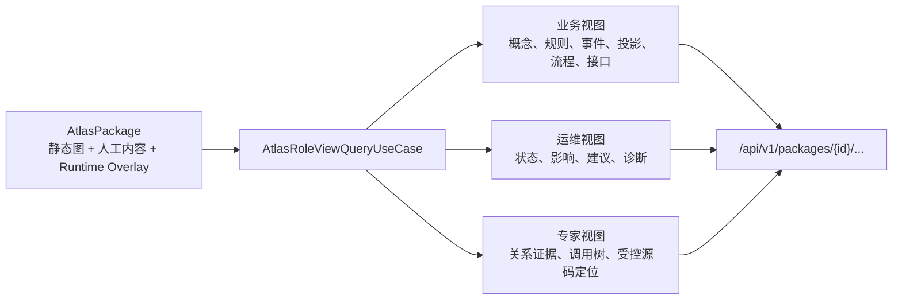

# 角色化查询与 HTTP 服务

## 结论

从本阶段开始，Atlas 不再只能作为离线 JSON 文件被开发者打开。服务端会把同一份 `AtlasPackage` 解释为三种稳定的读取模型：业务、运维和专家。前端只消费这些读取模型；它不扫描 Java、不会连接 Axon，也不能自己推断事件消费者或投影落点。



服务端不会返回原始 `AtlasPackage`，尤其不会把 Facts、未过滤的运行属性、本机 Workspace 路径或 source JAR 绝对路径当作 HTTP JSON 交给浏览器。

## 启动本地查询服务

先构建可执行 runner JAR：

```powershell
& 'C:\Program Files\JetBrains\IntelliJ IDEA Community Edition 2023.3.2\plugins\maven\lib\maven3\bin\mvn.cmd' `
  -pl ui-layer/atlas-server-bootstrap -am package
```

再启动服务：

```powershell
& 'C:\Program Files\Java\jdk-22\bin\java.exe' -jar `
  .\ui-layer\atlas-server-bootstrap\target\explicit-architecture-atlas-server-bootstrap-0.1.0-SNAPSHOT-runner.jar `
  --workspace .\workspace\local\atlas-workspace.yaml `
  --port 8080
```

启动器默认只绑定 `127.0.0.1` / 回环地址，且当前 V1 没有身份认证。因此它不能直接暴露到办公网或公网；将来需要远程访问时，应先放在具备认证、授权和审计能力的网关之后。

若需要让专家界面从 source JAR 展开源码，必须明确启用：

```powershell
& 'C:\Program Files\Java\jdk-22\bin\java.exe' -jar `
  .\ui-layer\atlas-server-bootstrap\target\explicit-architecture-atlas-server-bootstrap-0.1.0-SNAPSHOT-runner.jar `
  --workspace .\workspace\local\atlas-workspace.yaml `
  --enable-expert-source
```

此开关要求 `Workspace` 的 `sources.sourceArchives` 至少声明一个 source JAR。源码端点只会读取这些归档中、当前 Package 已知资产所对应的源码；客户端不能提交任意本机路径、归档路径或 `SourceLocator`。

## 路由

Package ID 是稳定文本，例如 `package:etc:current`。放入 URL path 时应进行 URL 编码，`:` 会表示为 `%3A`。

| 路由 | 用途 | 返回内容 |
| --- | --- | --- |
| `GET /health` | 服务存活检查 | `{ "status": "UP", "apiVersion": "1" }` |
| `GET /api/v1/packages/{id}/overview` | Package 摘要 | 来源版本、生成时间、节点/关系计数、覆盖声明、运行态可用性 |
| `GET /api/v1/packages/{id}/business` | 业务视图 | 领域概念、规则、事件、投影用途与落点、Saga、接口 |
| `GET /api/v1/packages/{id}/operations` | 运维视图 | 运行态采集可用性、Projection / Process Manager 健康度、影响目标、处置建议、诊断 |
| `GET /api/v1/packages/{id}/expert` | 专家视图 | 事件生产/消费证据、投影目的地关系、接口静态调用路径、源码定位 |
| `GET /api/v1/packages/{id}/assets/{assetId}` | 专家资产详情 | 属性、关系、可见证据、已脱敏 Runtime Observation 与 source 可用性 |
| `GET /api/v1/packages/{id}/assets/{assetId}/source` | 专家源码正文 | 仅在 `--enable-expert-source` 下，按 Package 已知资产从声明的 source JAR 返回源码 |

例如：

```text
GET http://127.0.0.1:8080/api/v1/packages/package%3Aetc%3Acurrent/business
GET http://127.0.0.1:8080/api/v1/packages/package%3Aetc%3Acurrent/operations
GET http://127.0.0.1:8080/api/v1/packages/package%3Aetc%3Acurrent/expert
```

## 三种视图的语义边界

### 业务视图

业务视图回答“业务如何运作”，而不是“Java 如何实现”。它包含领域概念及职责、领域约束的说明和正则表达式等可读约束、事件字段与生产/消费方、Projection 的用途和静态确认的数据目标、Saga 的启动/等待/完成事件及命令派发，以及 HTTP 接口的目的、方法、路径和直接命令。它不携带源代码、Java 全限定名、调用栈或 Event Store 细节。

### 运维视图

运维视图只在 Package 含 Runtime Overlay 时返回资产健康结论。如果尚未执行 `atlas observe`，则：

- `runtimeAvailability = NOT_CAPTURED`；
- 不返回虚假的资产健康度；
- 明确说明这既不是 `SUCCEEDED`，也不是某个资产的 `UNKNOWN`。

Runtime Overlay 存在后，Projection 和 Process Manager 的状态为 `SUCCEEDED`、`FAILED`、`LAGGING`、`RETRYING` 或 `UNKNOWN`。其中 `UNKNOWN` 仅表示“本次受控采集内没有可唯一关联的记录”，不是正常或成功。

返回的 `safeAttributes` 仍执行白名单防护，只允许延迟、重试次数、错误分类、处理组、消息身份等运维字段；payload、异常正文、堆栈和任意新字段不会因为已经进入 HTTP 层而重新暴露。

### 专家视图

专家视图提供支撑结论的静态边及其证据，也提供接口调用链。调用链从 `EndpointOperation` 开始，经过其 `REPRESENTS` 的代码元素，沿已证明的 `CALLS` 边向下展开；每条路径有 12 层深度、每个接口最多 64 条路径，以避免循环和异常大的图让界面失去可读性。

专家源码正文是独立端点，而不是放进专家图 JSON 中：

- 专家图只返回 `project://` 等受控定位符和行列范围；
- source 端点只接收稳定 `assetId`；
- 服务端先确认该资产属于 Package，再解析它自身或唯一的 `REPRESENTS → CodeElement` 映射；
- `SourceArchiveReader` 只在 Workspace 明确声明的 source JAR 中查找；
- 返回体不含 source JAR 或 Workspace 的绝对路径。

## 错误语义

所有响应均为 UTF-8 JSON。常见错误代码：

| HTTP 状态 | 错误代码 | 含义 |
| --- | --- | --- |
| `400` | `INVALID_REQUEST` | Package / 资产身份不合法等请求格式问题 |
| `404` | `PACKAGE_NOT_FOUND`、`ASSET_NOT_FOUND`、`SOURCE_NOT_FOUND` | Package、资产或受控源文件不存在 |
| `404` | `VIEW_NOT_FOUND`、`ROUTE_NOT_FOUND` | 不支持的视图或路由 |
| `405` | `METHOD_NOT_ALLOWED` | V1 查询 API 只支持 `GET` |
| `409` | `EXPERT_SOURCE_DISABLED` | 未显式启用 source JAR 查看 |
| `500` | `INTERNAL_ERROR` | 服务端无法完成查询；不会把内部异常或本机路径写回客户端 |

## 给后续渲染器的约束

前端或其他 HTTP 客户端应把这些 JSON 当成可渲染的解释模型，而不是二次分析输入：

- 业务页面渲染 `/business`，不自行从 `/expert` 拼装业务流程；
- 运维页面渲染 `/operations`，不把 `NOT_CAPTURED` 或 `UNKNOWN` 当绿色状态；
- 专家页面使用 `/expert` 的路径和定位符，再按用户动作请求 `/source`；
- 任何展示层都不得要求浏览器持有 Workspace 文件、source JAR 路径、Axon 凭据或原始运行 payload。
