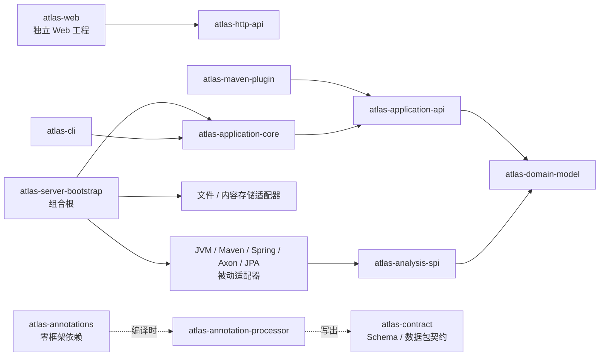
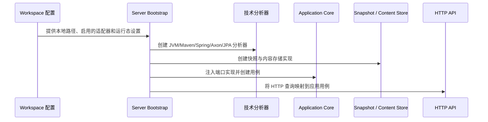

# 依赖规则与装配

## 结论

Atlas 的可读性依赖于“事实、意图、内容、渲染”可以独立演进。因此依赖必须从外向内收敛：领域模型不知道 Maven、Spring、Axon、JPA、HTTP、Node 或被分析项目；应用层只知道端口；技术框架只出现在对应适配器和最终组合根中。

虚线表示编译时意图提取，不是应用运行时调用。`atlas-annotations` 使用 `SOURCE` 保留策略，业务系统运行时不会因为声明架构意图而产生 Atlas 依赖。

## 各层允许知道什么

| 层 | 可以依赖 | 禁止依赖 | 原因 |
| --- | --- | --- | --- |
| `atlas-domain-model` | JDK | Spring、Axon、Maven、HTTP、文件存储、前端 | 它是跨工具、跨部署稳定的语义语言 |
| `atlas-application-api` | 领域模型、数据契约 | 具体框架、具体存储、UI | 用例与端口必须能被 CLI、插件、Server 平等调用 |
| `atlas-application-core` | 应用 API | Spring MVC、Axon SDK、React | 业务编排不应与启动方式耦合 |
| `atlas-analysis-spi` | 领域模型 | 各技术 SDK、Server | 是可替换分析器共同实现的窄端口 |
| `infra-driven/*` | SPI / 应用 API 和所需技术 SDK | Web 具体实现、其他无关适配器 | 每个适配器只解释一个技术事实源 |
| `infra-driving/*` | 应用 API / Core | 反向依赖 UI 或被动适配器细节 | 启动动作通过应用端口进入系统 |
| `ui-layer/atlas-http-api` | 应用 API | Spring Web、React、具体存储 | 保持 HTTP 语义边界可替换 |
| `atlas-server-bootstrap` | Core、选定适配器、HTTP API | 无限制禁止 | 唯一允许认识具体实现的组合根 |
| `atlas-web` | HTTP/数据契约 | Maven 的 Java 模块 | 作为独立部署的 UI 演进 |

## 被动与主动适配器

这里的“主动/被动”是相对于 Atlas 应用核心，而不是相对于被分析项目：

| 方向 | 模块示例 | Atlas 处于什么角色 | 输入/输出 |
| --- | --- | --- | --- |
| 被动（Driven） | `atlas-spring-source` | Atlas 主动读取技术事实 | 源码、注解、调用图 → 事实资产 |
| 被动（Driven） | `atlas-axon-runtime` | Atlas 主动读取运行观测 | 处理器/Saga/Event Store → 运行态证据 |
| 主动（Driving） | `atlas-cli` | 用户主动发起操作 | 命令行 → 应用用例 |
| 主动（Driving） | `atlas-maven-plugin` | 构建过程主动发起提取 | Maven 生命周期 → 应用用例 |
| 主动（Driving） | HTTP Controller（后续实现） | 浏览器/API 调用主动发起查询 | HTTP → 应用用例 |

这种区分是必要的：Spring `@PostMapping` 的源码扫描属于“被动适配器”，而暴露 Atlas 自己的 HTTP 查询接口属于“主动适配器”。两者都可能使用 Spring，但不能放在同一个“Spring 模块”里，否则分析被分析项目的逻辑会和运行 Atlas 服务的逻辑缠在一起。

## 为什么框架适配器各自发布

Spring、Axon、JPA 和 Maven 的升级节奏不相同，也不是每个 Atlas 用户都需要它们。将它们拆分带来三个直接结果：

1. **依赖最小化。** 只解析纯 Java 显式架构时可以只带 `atlas-source-jvm`；不用引入 Axon。
2. **版本隔离。** Axon 运行态适配器可依据运行环境单独选择兼容版本，不迫使核心模型升级。
3. **演进清晰。** `atlas-jpa-target-resolver` 的输出是“投影写入到哪里”的事实，而不是 UI 已决定如何画表结构。

每个适配器的输出都应经由 `SourceFactsAnalyzer` 或应用层端口归一为包含证据的 Atlas 资产。渲染器不能直接读取框架对象或扫描源码，否则无法解释来源可信度，也无法支持离线数据包。

## 组合根的职责

`atlas-server-bootstrap` 是唯一允许将具体实现接到端口上的地方。典型装配顺序如下：

组合根可以根据部署选择是否启用某个适配器，但不能把“没有启用 Axon”渲染成“没有事件”。界面必须明确显示该关系的证据状态是“未采集”还是“未实现”。

## 依赖审查清单

每次新增依赖时，至少检查：

- 是否可以通过现有领域模型或 SPI 表达，而不用让核心依赖具体 SDK？
- 是否真的每一种部署都会需要该库？如果不是，放入专用适配器。
- 是否会让注解 API、Schema 或领域模型依赖 Spring/Axon/Jackson？如会，拆分。
- 是否需要访问真实项目路径、密钥或运行数据？如需要，只能从 `workspace/local/` 或外部密钥系统注入。
- 是否让 `atlas-web` 读取源码、直接连数据库或理解 Maven？如会，应改为消费数据包或 HTTP API。

仓库中的 `atlas-architecture-conformance` 模块用于把这些规则逐步编码为自动化测试；它本身永不发布。
