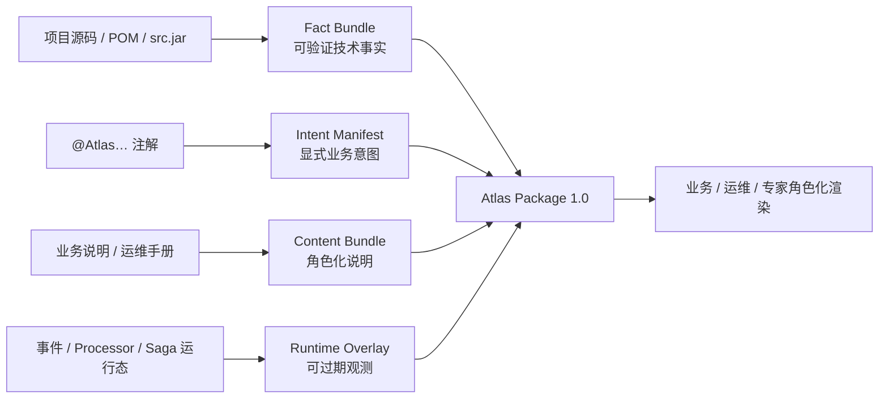

# 数据包、Workspace 与隐私边界

## 结论

Atlas 不把业务代码仓库搬进 Web 页面。它把来源、可信度和可见范围不同的信息编译为一个版本化 **Atlas Package**。渲染器只消费 Package；源码、`src.jar`、数据库凭据和运行态连接仍留在受控适配器与私有 Workspace 中。



当前三条静态链路已经实现 Facts、Intent、空 Content Bundle 和无 Runtime Overlay 的 Package：Maven/JVM 提取项目结构、代码约束与调用边；Spring/Axon 提取 HTTP 端点、命令派发、命令处理、事件生产/消费、payload 与 Saga 生命周期；JPA/Spring Data 提取持久化实体、显式表/列映射、Repository 类型绑定和投影写入点。没有安装或尚未实现的适配器会在 `manifest.coverage` 中显式声明 `NOT_IMPLEMENTED` 或 `NOT_ENABLED`，绝不以“零结果”暗示系统中没有相应能力。

## Atlas Package 的固定边界

`atlas-contract` 作为独立 Maven JAR 发布以下 Schema：

- `atlas.schema.json`：完整 Atlas Package；
- `atlas-intent.schema.json`：编译期 Intent Manifest；
- `atlas-content.schema.json`：人工维护的业务/运维内容；
- `atlas-runtime.schema.json`：运行态 Overlay；
- `atlas-workspace.schema.json`：私有 Workspace 配置；
- `atlas-convention-profile.schema.json`：可复用源码分析约定。

Package 的顶层固定为：

```json
{
  "manifest": {
    "schemaVersion": "1.0",
    "packageId": "package:example:2026-07-31",
    "projectId": "project:example",
    "sourceRevision": "git:abcdef",
    "generatedAt": "2026-07-31T10:00:00Z",
    "coverage": []
  },
  "designAtlas": { "nodes": [], "relations": [] },
  "facts": { "facts": [], "relations": [] },
  "intents": { "declarations": [] },
  "content": { "entries": [] },
  "diagnostics": []
}
```

其中 `designAtlas` 是渲染与查询的类型化节点图；`facts`、`intents`、`content` 与可选 `runtimeOverlay` 保留各自的来源语义。任何结论均必须带 Evidence；Evidence 使用 `project://`、`archive://`、`maven://`、`generated://` 等受控 URI，不能泄露本机绝对路径。

`schemaVersion` 的未知主版本必须被读取方拒绝或以显式策略降级，不能静默把字段误读为其他业务含义。

## 当前可验证提取范围

`atlas extract` 已接入如下输入：

| 输入 | 已产出的事实/语义 | 重要限制 |
| --- | --- | --- |
| JDK Java 语法树 | 类型、字段、方法、注解、`Pattern.compile`、常见 guard、可唯一解析的方法调用 | 不反射加载业务工程；无法唯一解析的调用不生成猜测边 |
| Maven POM | Reactor 模块、子模块关系、直接依赖 | 读取声明模型，不执行 Maven，不声称取得 effective POM |
| Spring 源码 | `@RequestMapping` 及其组合注解的 HTTP 方法/路由、明确 `CommandGateway`/`CommandBus` 的 `send`/`dispatch` | 不启动 Spring；动态路由、变量形式命令和无法确认接收器类型的派发不生成猜测边 |
| Axon 源码 | `@CommandHandler`、`AggregateLifecycle.apply(new Event)`、`@EventHandler`、`@SagaEventHandler`、事件字段、Saga 开始/等待/结束/命令派发 | 静态事实不等于 Event Store 已持久化或 Saga 已在生产环境运行；动态事件类型不生成猜测边 |
| JPA / Spring Data 源码 | `@Entity`、显式 `@Table` / `@Column`、Repository 泛型绑定，以及投影中可确认的 `save` / `persist` / `merge` 写入 | 不连接数据库；未显式声明 `@Table` / `@Column` 时只显示实体或属性，不按照命名策略猜测物理表/列 |
| Intent Manifest | 领域概念、约束、事件、投影、Process Manager、接口等显式语义 | 注解声明的是意图，不是生产运行证明 |
| Source Archive Reader | 依据 Package 的 `project://` 证据，在私有 Workspace `sourceArchives` 中延迟定位 `src.jar` 的源码条目 | 归档路径与源码内容不写入 Package；仅专家模式在受控白名单内读取 |
| 文件仓库 | Platform-safe JSON Package 原子写入与读回 | 文件名编码身份，Package 内保留原始 `packageId` |

例如 `@AtlasConstraint` 的 `businessMeaning` 成为业务视图中的规则说明，`expression`、对应 `Pattern`/guard 和源码位置仍作为专家证据保留。这样既能回答“为什么订单编号不能录入”，又能让开发者展开真实正则和执行点。

## Workspace 边界

仓库中的 `workspace/` 只放模板与公开说明；每台机器的真实配置必须位于被 Git 忽略的 `workspace/local/`。一个 Workspace 的典型布局为：

```text
workspace/
├─ atlas-workspace.example.yaml       # 可提交、无真实信息的模板
└─ local/                             # 不可提交：每台机器/部署环境私有输入
   ├─ atlas-workspace.yaml
   ├─ packages/                       # Atlas Package JSON 输出
   ├─ source-cache/                   # 经授权的 src.jar / 源码缓存
   ├─ content/                        # 真实业务、运维内容包
   └─ runtime/                        # 运行观测导出或安全连接配置
```

`AtlasWorkspaceYamlReader` 将私有 YAML 解析为应用层类型；`AtlasWorkspacePaths` 只计算 Workspace 内的标准输出目录；`AtlasPackageFileRepository` 用临时文件加原子移动写入 Package。三者均不把路径、凭据或内容复制进 Maven 工件或 Package。

`workspace/atlas-workspace.example.yaml` 的 Schema 1.0 形状如下：

```yaml
schemaVersion: "1.0"
workspaceId: "workspace:example-project"
project:
  id: "project:example-project"
  displayName: "示例 Explicit Architecture 项目"
sources:
  projectRoot: "<absolute-path-to-project>"
  sourceArchives: []
  intentManifests: []
content:
  root: "<absolute-path-to-private-content-pack>"
runtime:
  enabled: false
# conventionProfileFile: "<absolute-path-to-convention-profile.json>"
```

## Convention Profile 的职责

Profile 是可版本化、可复用的“技术约定 → FactKind”映射。它可描述某个注解、类型父接口、方法调用或包前缀应该产出哪类事实；但它不能直接制造业务节点。业务节点只能在 `DesignAtlasResolver` 中由真实 Facts、显式 Intent 与维护内容共同归一。

这个边界避免了“约定里写了存在 Saga，所以界面就说 Saga 已运行”一类误导：Profile 只影响发现方式，Package Evidence 与 Coverage 才决定结论可信度。

## 必须保留在私有边界内的内容

- 被分析项目的真实绝对路径、源代码、`src.jar`、私有依赖坐标；
- Event Store、Saga Store、业务数据库、消息平台和监控系统的连接参数；
- 密钥、Token、Cookie、证书、账号和认证头；
- 未脱敏的事件 payload、账号、证件、联系方式、客户案例与生产故障时间线；
- 真实业务文档、SLA、合作方信息和内部责任分配。

专家模式需要源码时，服务端应按 Package Evidence 的受控 URI 和 Workspace 白名单提供内容；Web 绝不能接收任意服务器路径后直接读取文件系统。

`SourceArchiveReader` 已提供受控的 `project://` → `src.jar` 查找：它仅接受 Workspace 明确给出的归档，拒绝 ZIP 条目路径穿越，并兼容 `src/main/java/...` 与普通 source JAR 的 `...` 两种布局。它返回的源码内容只留在本次专家模式读取中，不会回写到 Atlas Package。
