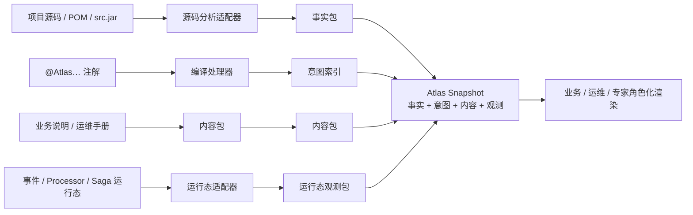

# 数据包、Workspace 与隐私边界

## 结论

Atlas 不是直接把一个业务代码仓库“搬进 Web 页面”。它把来源不同、可信度不同的信息转换成版本化数据包：技术分析产生**事实**，开发者注解产生**意图**，业务/运维维护产生**内容**，运行环境产生**观测**。渲染器只消费合并后的 Atlas 数据，而不是任意读取源码、数据库或生产凭据。



## 四类输入的职责

| 数据类别 | 典型来源 | 可以证明什么 | 不可以证明什么 |
| --- | --- | --- | --- |
| 事实包（Facts） | Java、Maven、Spring、Axon、JPA、调用关系 | 某类、方法、事件处理器、投影写入目标或依赖是否真实存在 | 业务名称、责任归属、处置建议是否正确 |
| 意图索引（Intent） | `@AtlasContext` 等源码注解、显式意图文件 | 开发者明确声明的概念、规则含义、流程职责 | 系统在生产环境是否已运行该能力 |
| 内容包（Content） | 业务文档、运维手册、ADR | 面向角色的解释、SLA、责任人、异常动作 | 源码中是否有真正执行点 |
| 观测包（Runtime） | Event Store、处理器、Saga、监控导出 | 某事件/投影/Saga 在某时刻的运行状态 | 设计是否合理、文档是否仍适用 |

合并器必须保留每一条结论的来源和状态。`DECLARED`、`DERIVED`、`RUNTIME_OBSERVED`、`PLANNED` 等不是标签装饰，而是避免把“计划中的自动流程”误导成“线上已经执行”的安全机制。

## `atlas-contract` 的作用

`atlas-contract` 是一个可独立发布的 JAR，携带 Atlas 数据包的 JSON Schema：

- `atlas.schema.json`：Atlas 资产快照的主契约；
- `atlas-content.schema.json`：人工说明、业务解释和运维动作的内容契约；
- `atlas-runtime.schema.json`：运行态观测契约。

Schema 与应用代码分开发布，目的是让以下消费者可以在不依赖 Server 或 Web 的情况下校验数据：离线分析 CLI、CI 规则、内容编辑器、第三方导入器、浏览器缓存服务和未来的 IDE 插件。

所有包均应携带 `schemaVersion`，而快照还应携带稳定的 `snapshotId`。任何读取方发现未知主版本时必须拒绝或以明确的兼容策略降级，不能静默把字段解释成错误的业务含义。

## 数据包最小形状

主 Schema 的最小快照形状如下；实际资产可以包含更多类型化字段和证据：

```json
{
  "schemaVersion": "0.1.0",
  "snapshotId": "example-2026-07-31T10:00:00Z",
  "assets": [
    {
      "id": "order-id-format",
      "kind": "DOMAIN_CONSTRAINT",
      "title": "订单身份格式",
      "evidence": [
        {
          "source": "DERIVED",
          "status": "VERIFIED",
          "locator": "src/main/java/.../OrderId.java"
        }
      ]
    }
  ]
}
```

业务页面可将其呈现成“订单编号为什么被拒绝”；专家模式再打开 `locator` 所指的源码、`src.jar` 条目、正则和测试。两种视图都来源于同一证据链。

## Workspace 边界

仓库的 `workspace/` 只存放模板和公开格式说明。真正运行 Atlas 的机器使用 `workspace/local/`，该路径被 `.gitignore` 忽略。

```text
workspace/
├─ README.md                         # 本目录的公开约定
├─ atlas-workspace.example.yaml      # 可提交、无真实信息的模板
└─ local/                            # 不可提交：每台机器/部署环境的私有输入
   ├─ atlas-workspace.yaml            # 真实项目根目录、开关、部署设置
   ├─ snapshots/                      # 生成的事实/语义快照
   ├─ source-cache/                   # 经授权的 src.jar 或源码缓存
   ├─ content/                        # 真实业务、运维内容包
   └─ runtime/                        # 运行观测导出或安全连接配置
```

`AtlasWorkspacePaths` 只负责计算 Workspace 下安全的标准路径；它不假定仓库中存在真实业务项目，也不硬编码任何绝对路径。`AtlasContentPaths` 在解析内容文件时阻止 `../` 路径逃逸，避免内容链接突破配置的根目录。

## 必须放在私有边界内的内容

以下内容一律不能提交、不能打进 Maven 工件，也不应出现在公开 fixture 中：

- 被分析项目的真实绝对路径、源代码、`src.jar`、私有依赖坐标；
- Event Store、Saga Store、业务数据库、消息平台和监控系统的连接参数；
- 密钥、Token、Cookie、证书、账号及认证头；
- 事件原始 payload 中的个人信息、账号、证件、联系方式和可识别业务数据；
- 真实运维故障、客户案例、生产时间线和内部责任分配；
- 业务文档中未脱敏的流程、SLA、外部渠道或合作方信息。

这不是“文档卫生”问题，而是 Atlas 产品的安全边界：Atlas 最终把知识面向非开发角色开放，必须默认以最小数据暴露原则工作。

## 内容包的治理方式

技术事实由分析器重复计算；业务解释由人维护，二者不能互相覆盖。内容包通过稳定 `assetId` 关联事实或意图资产，并明确面向的角色。例如仓库内的 `integration-test/fixture-packs/strict-explicit-java.content.yaml` 使用如下形状：

```yaml
schemaVersion: "0.1.0"
projectId: "strict-explicit-java-sample"
content:
  - assetId: "sample-order-id-format"
    audience: "BUSINESS"
    title: "订单身份格式"
    explanation: "用业务语言说明规则。"
    actionWhenViolated: "给出可执行的处理建议。"
```

如果内容包引用了不存在或已经删除的资产，CI 应报告“孤儿内容”；如果事实包发现新的关键约束但没有业务解释，CI 可以报告“待补充语义”。两者都不应自动猜测或静默忽略。

## 专家模式的源码展示

专家模式可以展示项目源码或 `src.jar`，但必须遵循两个规则：

1. 源码展示是有权限控制的证据展开层，不是业务人员默认界面；
2. Web 不能直接访问任意服务器路径。服务端应只根据快照证据和 Workspace 白名单，经由 `atlas-source-archive` 或安全的项目源码读取器提供受控内容。

`SourceArchiveReader` 已为 `src.jar` / ZIP 的 UTF-8 条目读取提供独立适配器锚点。未来加入行号、高亮、访问审计和缓存时，应扩展该适配器，不应让 UI 绕过 Server 直接读取文件系统。
