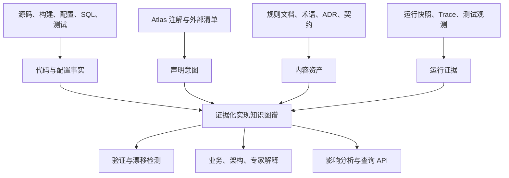

# 证据化实现解释与场景化执行模型

## 状态与目标

本文是 Explicit Architecture Atlas 的最终产品规格和实现契约。它定义 Atlas 如何面向任意 Java 工程解释实现细节，而不是只生成模块依赖图或静态调用图。

Atlas 的目标不是猜测业务含义，也不是要求开发者给所有代码重复写说明。它必须把下列内容合并为一个可追溯、可验证的知识模型：

- 源码、构建文件、配置、SQL、测试和框架声明直接证明的事实；
- 注解、清单和文档明确声明的稳定业务意图；
- 在明确规则和场景下推导的关系；
- 运行实例、测试或 Trace 实际观察到的结果；
- 无法可靠解析时保留的源码和未决项。

最终用户可以从业务能力、领域原语、规则、Endpoint、消息、Bean、类、函数、参数、返回值、数据库列或任意源码位置进入，并得到可回跳证据的解释。

## 不可妥协的原则

1. **证据优先。** 任何结论必须指向源码、配置、注解、文档或运行观测；生成的自然语言不是新的事实来源。
2. **不确定性显式化。** 反射、动态配置、自定义条件、程序化 Bean 注册等无法可靠解析时，Atlas 展示候选、条件和源码，绝不伪造唯一结果。
3. **一份代码，多种场景。** 不能把工程表示为一张单一调用图。必须区分可能图、场景解析图和运行观测图。
4. **值流优先于类型名。** 相同 Java 类型不代表相同业务含义；`String` 必须能表示原始输入、领域原语底层值、外部标识、持久化字段、敏感数据等不同语义。
5. **注解补充意图，不复制事实。** 标准框架、方法调用、表名、正则、guard 调用等由分析器提取；只有业务意义、私有约定、非显然关系和不可推导规则应由注解或清单声明。
6. **工作区源代码为第一证据。** 源码包和反编译仅用于外部依赖回退；不能把多模块工作区解释建立在 source archive 前提上。
7. **遗留、测试、生成与正式代码隔离。** 任何 source set 都有独立身份，默认不与当前生产架构混合。

## 证据等级

| 等级 | 含义 | 例子 |
| --- | --- | --- |
| `OBSERVED` | 直接由源码、构建、配置或运行信息观察 | `@Bean`、`gateway.pay()`、SQL 写入、运行中的代理类 |
| `DECLARED` | 开发者通过 Atlas 注解或外部清单声明 | 某值是领域原语、某私有 Gateway 是命令分发器 |
| `DOCUMENTED` | 绑定到稳定对象 ID 的人工解释或 ADR | 某规则的业务含义、例外与适用范围 |
| `DERIVED` | 由确定性规则从上述证据推导 | 参数传入 guard 后成为已验证值 |
| `RUNTIME_OBSERVED` | 指定部署、实例、测试或 Trace 的真实观察 | 生产实例选择了 RemotePaymentGateway |
| `UNRESOLVED` | 无法可靠解释的代码或环境依赖 | 自定义 `Condition` 依赖远程配置中心 |

任何界面和 API 输出都必须同时给出结论、证据来源、场景、置信状态和源码定位。

## 总体模型



Atlas 图谱由五个相互关联的核心语言组成：

1. `Code Model`：模块、文件、类型、函数、参数、局部变量、字段、调用、配置、SQL、测试。
2. `Semantic Value Model`：一个值的业务身份、表示、约束、来源、状态和转换。
3. `Operation Contract Model`：函数、构造器、框架入口或异步处理器的输入、前置条件、结果、副作用与失败路径。
4. `Component Runtime Model`：Bean/DI 定义、激活条件、注入解析、代理链、作用域和场景。
5. `Evidence Model`：所有资产、关系和解释的来源、可信度、版本、可见性和冲突状态。

## Semantic Value Model

Java 类型不是业务语义。Atlas 必须将“值的语义”与“值的 Java 表示”分离。

```text
SemanticValue
├── id                         稳定业务身份
├── name                       人类可读名称
├── category                   RAW_INPUT / DOMAIN_PRIMITIVE / IDENTIFIER / ...
├── javaRepresentation         Java 类型及泛型结构
├── domainRepresentation       值对象、DTO、事件字段或列的业务表示
├── cardinality                SINGLE / OPTIONAL / COLLECTION / MAP / STREAM
├── nullability                REQUIRED / OPTIONAL / CONDITIONAL / UNKNOWN
├── trustLevel                 EXTERNAL_UNTRUSTED / INTERNAL / VERIFIED / ...
├── sensitivity                PUBLIC / INTERNAL / PII / SECRET
├── normalization              trim、大小写、时区、精度、加密、脱敏等
├── constraints                关联的领域或边界约束
├── lifecycleState             RAW / VALIDATED / CANONICAL / PERSISTED / REDACTED
├── representations            HTTP、事件、数据库、外部协议中的对应表示
└── evidence
```

### 值的类别

最少支持以下受控类别：

- `RAW_INPUT`：HTTP、消息、文件、CLI 或外部系统的未信任输入；
- `DOMAIN_PRIMITIVE`：有稳定业务意义与规则的基本值；
- `VALUE_OBJECT`、`ENTITY_IDENTIFIER`、`AGGREGATE_STATE`；
- `COMMAND_PAYLOAD`、`EVENT_PAYLOAD`、`QUERY_FILTER`、`READ_MODEL_VALUE`；
- `PERSISTED_REPRESENTATION`、`EXTERNAL_REQUEST`、`EXTERNAL_RESPONSE`；
- `CONFIGURATION_VALUE`、`SECURITY_CONTEXT`、`TENANT_CONTEXT`、`TIME_SOURCE`；
- `ERROR_DETAIL`、`AUDIT_VALUE`、`SECRET`。

### Value Flow

值流记录“某个值如何到达另一个位置”，而不是只记录两个函数有调用关系。

```text
ValueFlow
├── sourceOccurrence            参数、字段、局部变量、返回值、事件字段、列或配置项
├── targetOccurrence
├── kind                        DIRECT_ASSIGNMENT / METHOD_ARGUMENT / RETURN_VALUE / ...
├── transformation              Mapper、Builder、trim、序列化、加密、脱敏等
├── condition                   仅在何种 Profile、配置、状态或分支下成立
├── preservation                原样、规范化、丢失信息、聚合、拆分、加密、不可逆
├── evidence
└── scenarioStatus
```

值流类型至少包括：`DIRECT_ASSIGNMENT`、`METHOD_ARGUMENT`、`RETURN_VALUE`、`FIELD_ASSIGNMENT`、`DTO_MAPPING`、`DOMAIN_PRIMITIVE_CONSTRUCTION`、`NORMALIZATION`、`VALIDATION`、`SERIALIZATION`、`DESERIALIZATION`、`EVENT_PAYLOAD_MAPPING`、`PERSISTENCE_WRITE`、`PERSISTENCE_READ`、`EXTERNAL_REQUEST_MAPPING`、`EXTERNAL_RESPONSE_MAPPING`、`ENCRYPTION`、`REDACTION`、`COLLECTION_ELEMENT_FLOW`。

## Operation Contract Model

每个方法、构造器、lambda、Endpoint、消息消费者、事件处理器、定时任务和框架回调都统一为 `Operation`。函数页面不得只展示签名和调用列表，而必须提供以下契约。

```text
OperationContract
├── identity
│   ├── stable ID / Java symbol / overload descriptor / source range
│   └── module、package、owner type、override/implementation relation
├── intent
│   ├── name、purpose、business capability、use case、owner
│   └── linked documentation and ADR
├── inputs
│   ├── explicit parameters
│   ├── receiver state (`this`)
│   ├── injected dependencies
│   ├── configuration values
│   ├── principal、tenant、locale、trace、transaction
│   ├── database/cache/external reads
│   └── time/random/environment/static inputs
├── preconditions
│   ├── nullability、format、authorization、state and invariants
│   └── idempotency、concurrency and transactional conditions
├── transformations
│   ├── semantic-value mapping and normalization
│   └── branch-specific conditions
├── outcomes
│   ├── Java return and semantic return
│   ├── receiver/entity state mutation
│   ├── event/message publication
│   ├── persistence/cache/audit writes
│   ├── external calls
│   └── async continuations
├── failures
│   ├── thrown exceptions、error code、error response mapping
│   ├── rollback/retry/fallback/compensation
│   └── swallowed/defaulted errors
├── effectiveInvocation
│   ├── DI resolution、runtime target、proxy/advisor chain
│   └── async boundary and transaction context
└── evidence
```

### 参数解释

每个显式或隐式输入应说明：Java 类型、泛型、语义值、参数角色、来源、可信度、可空性、默认值、格式和领域约束、归一化、敏感性、生命周期状态、使用位置和证据。对于同一 `String`，Atlas 必须能区分原始请求字段、已验证名称、外部 ID、错误消息和持久化列。

### 返回值解释

返回值不能只显示 Java 类型。它必须说明业务结果、可空性、异步包装、结果被谁消费、以及所有副作用。`void` 并不代表无结果：它可能改变聚合状态、发出事件、写库或调外部系统。`Optional`、`ResponseEntity`、`CompletableFuture`、Reactor `Mono/Flux`、分页和集合应分别解释容器语义及内部语义值。

### 方法摘要

为支持跨模块、跨调用的可扩展分析，每个 Operation 生成可组合的摘要：

```text
parameter #0 -> return
parameter #0 -> field aggregate.name
parameter #1 -> external request body.customerId
database read -> return
aggregate state -> emitted event payload
guard predicate -> failure outcome
configuration key -> conditional branch
event publication -> asynchronous consumer
```

摘要必须保留条件与证据；无法形成可靠摘要时保留原始源码片段和未解析状态。

## Domain Primitive、Guard 和规则语言

`DomainPrimitive` 是一等领域资产，不应被降格为普通单字段 record、DTO 或 util 调用。一个领域原语需要表达：业务名称、底层表示、构造/再水合方式、规范化、构造期不变量、状态变更规则、失败类型、生产者、消费者、事件/持久化/API 表示和绕过风险。

工程内的 guard/require/assert 库必须建模为 `GuardDefinition`，以便对其所有调用点做一致解释。一个 guard 的参数有不同角色，不能按普通函数参数处理：被约束值、Predicate、Pattern、消息、错误码、上下文或默认值。

示例：

```java
@AtlasGuard(
    kind = AtlasConstraintKind.NON_BLANK,
    subjectParameter = 0,
    messageParameter = 1,
    success = AtlasGuardSuccess.PASS_THROUGH_SUBJECT,
    failureType = BusinessException.class)
static String requireNonBlank(String value, String message) { ... }

@AtlasGuard(
    kind = AtlasConstraintKind.PREDICATE,
    predicateParameter = 0,
    messageParameter = 1,
    acceptedWhen = AtlasTruthValue.TRUE,
    success = AtlasGuardSuccess.PROVES_PREDICATE,
    failureType = BusinessException.class)
static void requireTrue(boolean condition, String message) { ... }
```

对于“条件为真时抛异常”的 guard，`acceptedWhen` 必须显式表示 `FALSE`。分析器应解析可识别的长度、模式、相等、状态和范围谓词；复杂表达式保留 AST/源码，并标记为 `PREDICATE` 和 `UNRESOLVED`，等待人工规则说明。

规则还必须带 `EnforcementLevel`：构造期领域不变量、状态变更不变量、边界校验、应用层前置条件、持久化约束、运行策略、外部系统约束。界面不得把入口 `@Valid` 误展示为领域对象已经安全。

## Component Runtime Model：Bean、DI、配置与代理

### Bean Definition

`BeanDefinition` 是从 `@Component`、`@Service`、`@Repository`、`@Controller`、`@Bean`、XML、自动配置、FactoryBean、程序化注册或测试配置得到的组件定义。它包含名称、声明/实际候选类型、工厂方法、Scope、lazy、primary、qualifier、priority、生命周期、条件、依赖、代理要求和证据。

### Injection Point

`InjectionPoint` 独立建模请求类型、泛型、注入方式、`@Qualifier`、required、集合/Optional/Provider 模式和候选 Bean。支持构造器、字段、setter、方法参数、`@Lookup`、`ObjectProvider`、`ObjectFactory`、`ApplicationContext#getBean`、`BeanFactory#getBean` 和程序化查找。

### 激活条件

所有配置条件统一规范化为 `ConditionExpression`：

```text
AND(
  profile("prod"),
  property("payment.gateway") == "remote",
  classPresent("example.RemotePaymentClient"),
  missingBean(type = "example.PaymentGateway")
)
```

至少支持 `@Profile`、Spring Boot 的 `@ConditionalOn*`、`@Conditional`、`@Import`、Auto Configuration、`ConfigurationProperties`、Property Placeholder、XML/Java 配置、测试覆盖、动态属性和外部配置。自定义 `Condition` 不可静态判断时必须保留其代码、输入和未决状态。

### Bean Resolution

Bean 解析器必须尽量与具体 DI 框架等价，而不是只按裸类型匹配。Spring 插件至少处理：泛型兼容、`@Qualifier`、`@Primary`、Bean 名称、`@Priority/@Order`、单候选、`Optional<T>`、`List<T>`、`Set<T>`、`Map<String,T>`、`ObjectProvider<T>`、Scope、FactoryBean、scoped proxy、parent context 和测试替身。

```text
BeanResolution
├── injectionPoint
├── candidateDefinitions
├── exclusionReasons
├── selectionRules
├── selectedBeanByScenario
├── runtimeObservedBean
└── evidence
```

### Proxy 和 AOP

有效调用必须区分声明目标、注入目标、代理对象、Advisor 链和最终目标方法。至少识别安全、校验、事务、重试、熔断、缓存、异步、指标和自定义 AOP。自调用绕过代理、代理顺序冲突、异步/事务边界错位应产生专家诊断。

### 配置场景

场景不是若干 YAML 文件，而是版本化的 `ConfigurationScenario`。它必须包含 Profile、属性及来源、Classpath 能力及其**完整性**、秘密脱敏策略，以及一个 `ApplicationContextScope`。后者标识启动入口、根 Maven 模块、由 Maven 依赖闭包得到的本地源码范围、Spring 组件扫描范围、显式 `@Import` 组成、Bean 覆盖策略和经过证实的覆盖获胜者。一个仓库里可能有多个 Spring Boot 进程；没有应用上下文的历史场景只能表示 `PotentialGraph`，不能声称是任一进程的有效 Bean 图。

同一源码在不同场景必须得到不同的 `ScenarioGraph`。未指定场景时返回 `PotentialGraph`；运行时连接器生成 `ObservedGraph`，三者都不可互相覆盖。

### 已实现的命名 Workspace 场景契约

Atlas 不从 CLI 进程的环境变量、当前 Spring `Environment` 或任意本机 YAML 自动猜测场景。使用者必须在私有 Workspace 中声明可复现场景，`extract` 才会将经过脱敏的 `ConfigurationScenario` 编译进 Package：

```yaml
schemaVersion: "1.0"
workspaceId: "workspace:payments"
project:
  id: "project:payments"
  displayName: "Payments"
sources:
  projectRoot: "../payments"
  sourceRoots: ["../payments/service/src/main/java"]
  excludedPaths: ["../payments/.tmp", "../payments/legacy-reference"]
  sourceArchives: []
  intentManifests: []
scenarios:
  - id: "scenario:production"
    name: "生产主链路"
    activeProfiles: ["prod", "cloud"]
    properties:
      payment.gateway:
        provenance: "application-prod.yml"
        value: "remote"
        redacted: false
      payment.api-token:
        provenance: "vault"
        redacted: true
    classpathCapabilities: ["com.example.payment.RemoteClient"]
    # 未列出的 class 不等于不存在；只有 COMPLETE 才允许 ConditionalOnClass 因缺失而排除 Bean。
    classpathCompleteness: "PARTIAL"
    applicationContext:
      id: "context:payments-api"
      entryPointTypes: ["com.example.payments.PaymentsApplication"]
      rootModuleCoordinates: ["com.example:payments-api:1.4.0"]
      sourcePathPrefixes: []
      componentScanPackages: []
      beanDefinitionOverridePolicy: "FORBID"
      explicitBeanOverrides: {}
```

`sourceRoots` 与 `excludedPaths` 必须位于 `projectRoot` 内。若没有指定 `sourceRoots`，JVM 适配器只发现所有模块的 `src/main/java`；仅当工程完全没有这类约定根时才回退到项目根。`target`、`build`、`out`、`.git`、`.gradle`、`.idea`、`node_modules`、`.tmp` 和任意 `test` 目录始终不属于默认生产图。这样旧工程镜像、迁移暂存目录和测试替身不会制造虚假的 Bean 候选或调用边。

每个属性必须明确 `redacted`。`redacted: true` 时，值在 `ScenarioProperty` 的领域构造阶段就被清为空字符串，既不会写入 Package JSON，也不会通过 HTTP 返回；解析器只保留“该属性存在但值不可见”，相应条件结果为 `UNRESOLVED`。`redacted: false` 的值属于可导出、可审计的场景事实，不能填写密钥、令牌、个人数据或原始请求体。

当前 Spring 场景解析已实现：`@Profile` 的 `!`、`&`、`|`、括号表达式；`@ConditionalOnProperty` 的 `prefix`、`havingValue` 与 `matchIfMissing`；Classpath 存在/缺失；`@ConditionalOnBean`、`@ConditionalOnMissingBean`、`@ConditionalOnSingleCandidate`；`@Qualifier`、`@Resource(name)`、`@Named`、`@Primary`、单构造器隐式注入、集合/Map/Optional/Provider。JVM 分析器还会从源码 AST 提取 `extends`/`implements`，因此 `PaymentGateway` 注入可以匹配实现它的 `RemotePaymentGateway`，而不是只做裸字符串相等；条件注解中的 `PaymentGateway.class` 也会先规范化为类型名。多个候选但唯一 `@Primary` 时，`@ConditionalOnSingleCandidate` 按 Spring 语义成立。

解析先按 `rootModuleCoordinates` 计算 Maven 本地反应堆的传递依赖闭包，再读取入口 `@SpringBootApplication` 的 `scanBasePackages` 与 `@Import`。因此同一个包名下、但未在 `app-backend` classpath 或组成根中的 `read-backend` Bean 不会成为候选；反之，`@Import` 的查询 Controller、Service、Adapter 与其 `@Bean` 工厂方法会被纳入。`@Bean` 保留 `definitionType` 和 `factoryMethod`，不能只以返回类型推断它是否属于入口配置类。Classpath 清单为 `PARTIAL` 时，未列出的 `@ConditionalOnClass`/`@ConditionalOnMissingClass` 结果是 `UNRESOLVED`；只有 `COMPLETE` 才可据缺失排除/激活。

同名活动 Bean 也不再按源码扫描顺序选择：`FORBID` 表示应用无法以该图完成启动；`ALLOW` 但缺少注册顺序或 `explicitBeanOverrides` 获胜者时为 `UNRESOLVED`；只有显式获胜类型唯一匹配时才排除被覆盖定义。条件 Bean 的顺序、循环、红acted属性、自定义 `Condition` 或动态查找无法由静态场景唯一决定时，输出同样必须是 `UNRESOLVED`。

Spring 源码适配器同时提取 `@Value`，以及类型级 `@ConfigurationProperties(prefix = "...")` 的前缀和非静态字段绑定。例如 `PaymentRetryProperties.maxAttempts` 会以规范化键 `payment.retry.max-attempts` 进入配置图，并与读取它的源码位置相连。字面默认值只作为声明事实保存；键名含 `password`、`secret`、`token`、`credential`、`api-key`、`private-key` 或 `access-key` 时，默认值在事实生成前清空并标记为 `SECRET`，不能借由 Package、CLI 或 HTTP 再次导出。

场景解析的输出不止是 Bean 列表。对已被静态解析的每条 `CALLS` 边，Atlas 另外生成 `ScenarioInvocationResolution`：

```text
ScenarioInvocationResolution
├── callerCodeId                    调用方源码方法
├── staticTargetCodeId              编译期/静态目标声明
├── receiverInjectionPointIds       接收者与哪些 InjectionPoint 有证据关联
├── candidateComponents             该注入点在本场景的活动候选
├── selectedComponents              依据 Qualifier/Primary 等选中的 Bean
├── effectiveTargetCodeIds          能唯一定位的本地具体实现方法
├── declaredAdvisorIds              作用于组件或方法的源码声明 Advisor
├── status                          STATIC_ONLY / EXCLUDED / UNRESOLVED / RESOLVED
└── reasons                         选择或拒绝选择的可读原因
```

`RESOLVED` 的门槛是：调用方组件已激活；调用表达式的接收者与该组件的注入点匹配；该注入点在场景中选择唯一 Bean；并且 Package 内能唯一定位该 Bean 的具体方法实现。接口 `Gateway.charge()`、已选中的 `RemoteGateway` 和 `RemoteGateway.charge()` 是三个不同层次，绝不可把其中任一个替代另一个。调用未能关联到 DI 接收者时状态为 `STATIC_ONLY`；调用方被排除时为 `EXCLUDED`；属性被脱敏、存在多个候选、Provider 延迟查找、实现方法不在本地源码或重载无法可靠分派时为 `UNRESOLVED`。Advisor 当前是源码声明候选，只有 Runtime Adapter 观察到代理链后才可断言其实际执行顺序。

查询入口如下，三者复用同一 `DefaultConfigurationScenarioResolver`：

```text
atlas extract  --workspace atlas-workspace.yaml --package-id package:payments
atlas scenario --workspace atlas-workspace.yaml --package-id package:payments --scenario-id scenario:production
GET /api/v1/packages/package:payments/scenarios/scenario:production
GET /api/v1/packages/package:payments/endpoints/endpoint:payments-create/trace
```

HTTP 入口只允许引用 Package 中已有的稳定场景 ID；它不接受 Profile、属性或文件路径覆盖，因而不能被请求者用来读取或影响服务器环境。

## 图与关系语言

关系必须携带条件、场景和证据。既有关系之外，最终模型至少支持：

- `ARGUMENT_BINDS_TO`、`RETURN_FLOWS_TO`、`DERIVES_FROM`、`NORMALIZES`、`VALIDATES`；
- `MUTATES_STATE`、`READS_FROM`、`WRITES_TO`、`SERIALIZES_AS`、`DESERIALIZES_FROM`；
- `IMPLEMENTS`、`OVERRIDES`、`DELEGATES_TO`、`LOOKS_UP`；
- `DEFINES_BEAN`、`REQUESTS_BEAN`、`RESOLVES_TO`、`ACTIVATES_WHEN`、`EXCLUDES_WHEN`；
- `PROXIES`、`INTERCEPTS`、`BYPASSES_PROXY`、`CROSSES_ASYNC_BOUNDARY`；
- `PUBLISHES`、`CONSUMES`、`PROJECTS_TO`、`PERSISTS_TO`、`CALLS_EXTERNAL`;
- `BYPASSES_DOMAIN_PRIMITIVE`、`CONTRADICTS`、`DOCUMENTS`、`EVIDENCED_BY`。

每条边需说明直接/推导/声明/运行观测来源、条件表达式、适用场景、有效时间、置信度、源码位置和可见性。

## 注解、清单与内容契约

注解 API 保持零框架依赖和编译期性质。现有角色注解之外，最终 API 提供：

| 注解或清单 | 目的 |
| --- | --- |
| `@AtlasDomainPrimitive` | 声明稳定业务值、底层表示、名称和说明 |
| `@AtlasGuard` | 一次性解释私有 guard/constraint 方法的参数和成功/失败语义 |
| `@AtlasRuleSet`、`@AtlasRule` | 为可复用规则集和复杂规则提供稳定业务 ID 与描述 |
| `@AtlasOperation` | 标记重要操作的业务目的、用例和能力 |
| `@AtlasInput`、`@AtlasOutput` | 补充不从类型可推导的参数/返回语义 |
| `@AtlasPrecondition`、`@AtlasPostcondition`、`@AtlasEffect`、`@AtlasFailure` | 声明重要契约和结果 |
| `@AtlasAdapter` | 一次性定义私有 Gateway、Publisher、Writer、Repository 或框架包装语义 |
| `@AtlasOperationSummary` | 为无源码或复杂封装提供可验证摘要 |
| `@AtlasMigrationMapping`、`@AtlasCompatibilityTarget` | 关联遗留和新系统实现 |

注解不适合修改的第三方或遗留类型通过 `ConventionProfile` / 外部清单映射。文档以稳定 ID 绑定到资产、规则、操作、配置键或场景；代码改变后通过源哈希和关系校验标记文档漂移。

## 源码、Source Set 与依赖源码

工作区必须显式声明 source set：当前生产代码、测试、生成代码、遗留参考、外部依赖源码。扫描器根据 Maven/Gradle 模块根和显式 include/exclude 解析，而不是从工程根无差别遍历。`target`、`.git`、IDE 缓存、Node 依赖与未指定的遗留树默认不参与生产图。

专家视图以工作区源码为优先；外部类型依次使用 source jar、字节码签名、反编译回退，并清晰标记证据等级。任意单文件/AST 节点解析失败都必须隔离为诊断，不能导致整个分析器输出空事实。

## 运行证据与安全

可选运行时连接器采集运行实例的 Profile、有效配置键来源、Bean Definition、实际 Bean/代理、Advisor、Condition Evaluation、Endpoint、Listener、任务和 Trace。它不导出默认不可见的密钥、个人数据、请求体或源码；采集范围、实例、版本、时间和配置指纹均须记录。

运行观测用于确认或否定某个场景中的可能路径，不能覆盖设计事实。生产环境只上传经过脱敏和访问控制的事实摘要。

## 解释与查询体验

### 函数视图

给出函数目的、每个显式/隐式输入、语义值流、前置条件、调用和有效运行目标、代理链、返回和副作用、异常、事件、持久化、外部调用、测试、场景切换与源码证据。

### 领域原语视图

给出业务定义、底层表示、构造/再水合、规则、guard、异常、使用者、序列化、持久化、事件载荷、API 表示和裸值绕过路径。

### 场景视图

给出所有有效 Profile、关键属性、Bean 激活/排除、注入解析、代理链、Endpoint、消息 Listener、任务和未决条件。

### 追踪查询

至少支持：

- 从某 HTTP 字段追踪到领域原语、事件、投影、列和响应；
- 从某个函数参数追踪到所有下游消费者；
- 从返回值追踪到最终 API、消息或持久化结果；
- 从配置键追踪到受影响 Bean、函数、外部系统和测试；
- 从规则或领域原语执行影响分析；
- 比较两个场景下的有效调用链、Bean 和副作用；
- 显示某个结论的全部证据及冲突。

自然语言解释器只能以图谱中的证据为输入，并在每个句子或段落保留证据引用；它不得以未验证推测写入规范模型。

## 验证、治理与漂移检测

### 编译期

注解处理器验证稳定 ID、目标存在性、参数索引、guard 参数角色、类型约束、重复规则 ID、适配器方法存在性、引用完整性和明显冲突。

### 构建期

CLI/CI 验证分析器完成度、源集覆盖、事实数量、诊断、文档引用、场景可解析性、Bean 歧义、规则覆盖、裸值绕过、投影端到端链路、对外契约、依赖分层和隐私策略。

### 漂移

比较上一次已确认 Package 与当前代码、注解、配置、文档和运行快照，输出新增/删除/变化规则、配置导致的路径变化、文档过期、失效条件、Bean 选择改变、Proxy 链变化、事件/投影断链和未复核例外。

### 例外

反射、动态 SQL、动态路由、脚本和其他不可分析实现必须生成显式 `UNRESOLVED` 或 `DECLARED_EXCEPTION`，且可指定 owner、原因、审查日期与补充证据。沉默丢弃不能作为成功。

## 实现边界与模块职责

最终实现保持现有“领域模型—应用端口—技术适配器—组合根”的依赖方向，并新增或扩展以下职责：

| 模块/职责 | 最终责任 |
| --- | --- |
| `atlas-domain-model` | 上述统一语义、证据、值流、操作、组件、场景和关系模型 |
| `atlas-contract` | Package、Workspace、Scenario、Convention Profile 与 JSON Schema |
| `atlas-annotations` | 零框架意图注解 |
| `atlas-annotation-processor` | 注解校验与意图索引 |
| `atlas-analysis-spi` | 源码、配置、运行态和组件分析的可替换端口 |
| `atlas-source-jvm` | 安全 AST、符号、函数摘要、guard、值流和 source set 分析 |
| `atlas-spring-source` | Spring Bean、条件、注入、Endpoint、AOP 声明和配置引用 |
| `atlas-spring-runtime` | 可选 Spring runtime snapshot/condition/proxy 观测（新增） |
| `atlas-configuration-source` | YAML/properties/Profile/config provenance（新增） |
| `atlas-application-core` | 事实、声明、内容、场景、观测的归一化、验证和解释编排 |
| `atlas-file-store` | 配置场景、内容、约定映射和数据包读写 |
| `atlas-cli` | scan、scenario、explain、trace、impact、verify、diff 命令 |
| `atlas-http-api` / Web | 角色化且可追溯的查询和场景切换 |
| fixtures / integration tests | 多 Bean、多 Profile、条件、AOP、guard、值流与漂移端到端验证 |

## Maven 发布边界与可选框架策略

### 发布原则

Atlas 对 Maven 使用者的第一个承诺是：**未选择的框架不会作为传递依赖进入其工程。** 这不仅意味着核心代码不 import Spring/Axon/JPA，也意味着发布 POM 的依赖图不能把这些能力藏在 core、BOM、CLI 基础工件或通用 starter 后面。

因此发布单元按“稳定核心、通用能力、框架适配器、组合分发”四层划分：

```text
explicit-architecture-atlas-bom                    仅 dependencyManagement，不引入能力
│
├── explicit-architecture-atlas-core               零框架核心 Facade
│   ├── domain-model
│   ├── application-api
│   ├── application-core
│   └── analysis-spi
│
├── explicit-architecture-atlas-annotations        仅编译期注解 API
├── explicit-architecture-atlas-annotation-processor
├── explicit-architecture-atlas-contract            JSON Schema 与公共契约
│
├── explicit-architecture-atlas-source-jvm          Java 语言分析（无 Spring/Axon/JPA）
├── explicit-architecture-atlas-maven-source        Maven 结构分析（无业务框架）
├── explicit-architecture-atlas-file-store          本地 JSON/YAML 存储（Jackson 仅在此边界）
├── explicit-architecture-atlas-content-store       内容存储
│
├── explicit-architecture-atlas-spring-source       Spring 源码/Bean/条件适配器
├── explicit-architecture-atlas-axon-source         Axon 源码适配器
├── explicit-architecture-atlas-axon-runtime        Axon 运行观测适配器
├── explicit-architecture-atlas-jpa-target-resolver JPA/Hibernate 源码适配器
└── 其他 framework-specific adapters                通过 analysis SPI 按同一边界扩展，当前不作为已发布工件宣称

组合工件（CLI、Server、Starter、示例）
├── explicit-architecture-atlas-cli                 内置 JVM/Maven 通用分析，不传递引入 Spring/Axon/JPA
├── explicit-architecture-atlas-cli-full            显式组合全部已发布适配器的 fat JAR
├── atlas-starter-jvm                               显式选择 Java/Maven 分析
├── atlas-starter-spring                            在 JVM 基础上额外引入 Spring 适配器
├── atlas-starter-axon                              在 JVM 基础上额外引入 Axon 适配器
├── atlas-starter-jpa                               在 JVM 基础上额外引入 JPA 适配器
└── atlas-starter-full                              仅作为显式选择的完整分发，不是默认入口
```

`atlas-core` 是面向嵌入式使用者的唯一核心 Facade；它只依赖 Atlas 自己的领域/应用/SPI 模块和 JDK。`atlas-bom` 只管理版本，绝不能通过普通 `<dependencies>` 自动引入任何 adapter。每个 adapter 对第三方框架 SDK 的依赖都只出现在它自己的 POM 内；如果分析实现仅使用 JDK AST 和框架注解名称，则也不得因为命名关系而引入该 SDK。

### 使用方式

纯 Java 工程只需要：

```xml
<dependencyManagement>
  <dependencies>
    <dependency>
      <groupId>io.github.vicliu624.explicitarchitecture</groupId>
      <artifactId>explicit-architecture-atlas-bom</artifactId>
      <version>${atlas.version}</version>
      <type>pom</type>
      <scope>import</scope>
    </dependency>
  </dependencies>
</dependencyManagement>

<dependencies>
  <dependency>
    <groupId>io.github.vicliu624.explicitarchitecture</groupId>
    <artifactId>explicit-architecture-atlas-core</artifactId>
  </dependency>
  <dependency>
    <groupId>io.github.vicliu624.explicitarchitecture</groupId>
    <artifactId>explicit-architecture-atlas-source-jvm</artifactId>
  </dependency>
</dependencies>
```

只有需要 Spring Bean/条件/AOP 解释时才额外声明 `explicit-architecture-atlas-spring-source` 或对应 starter；只有需要 Axon、JPA、MyBatis 事实时才引入相应 adapter。用户引入 core 或 JVM analyzer 时，依赖树中不得出现 `org.springframework:*`、`org.axonframework:*`、`jakarta.persistence:*`、JDBC driver 或其他未选择框架的 SDK。

### CLI 与 Server 的组合规则

CLI 和 Server 是组合根，不得把“所有适配器”作为基础库依赖。它们通过 `ServiceLoader`/显式注册发现 classpath 上已经选择的 `SourceFactsAnalyzer` 和运行态 adapter：

- 普通 `atlas-cli` 内置 JVM 与 Maven 两个通用分析器，因此可直接解释不使用任何业务框架的 Java/Maven 工程；它不携带 Spring、Axon、JPA 或 JDBC adapter；
- `atlas-cli-full` 是单独发布的便利 fat JAR，显式选择 `atlas-starter-full`；普通 CLI 与嵌入式核心不会因此得到全量框架依赖；
- 适配器 artifact 在自己的 `META-INF/services` 中发布 provider；
- Starter 或用户 POM 决定额外哪些 provider 位于 classpath；fat JAR 必须合并所有 `META-INF/services` 文件，不能因打包覆盖任一 provider；
- `atlas-starter-full` 可以提供便利的完整分发，但必须是明确选择，且不会替代 core；
- Server 也按相同机制装配，不能因启动 HTTP 服务而顺带拉入 Spring/Axon/JPA 分析器。

这使同一个 CLI 命令在纯 Java、Spring、Axon 或 JPA 工程中拥有不同的分析能力集合；Package Manifest 必须列出实际运行的 analyzer 及其覆盖状态。没有位于 classpath 的 adapter 只能被标注为“未安装/未请求”（若 Workspace 明确请求它），绝不能误显示为“未发现事实”。

### 自动化依赖泄漏验证

发布前必须执行依赖边界测试，至少覆盖：

| 被验证工件 | 断言 |
| --- | --- |
| `atlas-core` | 无 Spring、Axon、Jakarta Persistence、JDBC、Jackson、Maven Plugin、HTTP/Web 传递依赖 |
| `atlas-annotations` | 仅 JDK；无 Atlas runtime、框架或 JSON 依赖 |
| `atlas-analysis-spi` | 仅领域模型；无任何框架 SDK |
| `atlas-source-jvm` | 仅 core/SPI/JDK；无 Spring/Axon/JPA SDK |
| `atlas-spring-*` | 仅该适配器可出现 Spring 相关依赖 |
| `atlas-axon-*` | 仅该适配器可出现 Axon 相关依赖 |
| `atlas-jpa-*` | 仅该适配器可出现 JPA/Hibernate/JDBC 相关依赖 |
| `atlas-cli` | 仅携带 JVM/Maven 通用分析，不传递引入任何 framework-specific adapter |
| `atlas-starter-*` | 只引入名称所声明的 adapter 集合 |

验证采用 Maven Enforcer 规则、构建后的 POM 解析测试以及消费者 fixture：每个 fixture 仅依赖一个公开 artifact，然后断言其解析依赖图中没有禁止 groupId。该测试是发布门禁，而不是文档约定。

## 完成定义

只有在以下能力均有代码、测试和端到端数据包证据时，本规格才算完成：

1. 任意重要函数可展示输入、返回、副作用、异常、调用、参数绑定和返回流；
2. 领域原语与 guard/规则被识别、解释、回跳源码并可检测绕过；
3. Spring Bean、Profile、Property、Condition、Qualifier、Primary、Factory、Scope 和 AOP 被建模；
4. 同一源码在两个配置场景中生成不同的有效 Bean/调用图；
5. 运行快照可确认实际 Bean、代理链和条件结果，且不泄露秘密；
6. 无法可靠解析的动态机制显式保留为未决项；
7. 文档、注解、源码、配置、测试和运行证据可以双向跳转并检测漂移；
8. CLI、HTTP/API 和 Web 都能查询 Package、选择场景、解释函数与追踪值流；
9. 多模块工作区、外部源码、测试、生成代码和遗留源码不会在默认生产图中混淆；
10. CI 对空事实、分析器失败、无效注解、断裂文档和关键语义漂移失败或产生可审查诊断。
