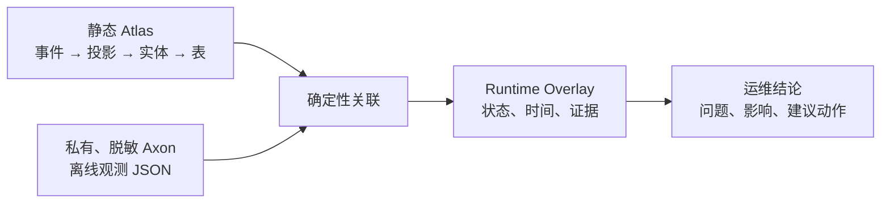

# 运行态投影健康度与运维处置

## 结论

Atlas 的静态图回答“某事件设计上应该由谁消费、投影应写到什么实体和表”；Runtime Overlay 回答“本次受控采集中，它是否已处理、失败、积压、重试或根本没有采到状态”。两者绝不混为同一种事实：静态 Package 仍可独立审计，运行态 Overlay 则带采集时间且天然可过期。



Atlas 不会因为没有一条运行态记录就宣称处理成功。对于本批次未收到可唯一关联记录的 Projection 或 Process Manager，会显式产生 `UNKNOWN` 状态，含义是“未采集到”，不是“正常”。

## 导入边界

运行态输入只来自 Git 忽略的 `workspace/local/` 或受控安全导出目录。Workspace 中必须明确启用并声明文件：

```yaml
runtime:
  enabled: true
  observationFiles:
    - "runtime/axon-observations.json"
```

`observationFiles` 的本机路径不会写入 Atlas Package。Overlay Evidence 仅使用受控的 `runtime://axon/offline-export-N` URI，避免泄露部署目录。

当前 V1 是**离线导入**，不连接 Event Store、Saga Store、投影数据库、消息系统或日志平台，也不保存连接字符串、Token、Cookie、原始事件 payload 或异常栈。将来即使增加实时采集，也必须先归一为同一份 `RuntimeSignalBatch` 契约，不能绕过这一边界直接把运行时 SDK 对象交给 Web。

## Axon 离线观测文件

Schema 位于 Maven 工件 `atlas-contract` 的 `atlas-axon-runtime-observations.schema.json`。单个导出文件的最小形状如下：

```json
{
  "schemaVersion": "1.0",
  "capturedAt": "2026-07-31T08:00:00Z",
  "observations": [
    {
      "id": "obs:order-summary:42",
      "eventType": "example.atlasfixture.OrderCreated",
      "handlerType": "example.atlasfixture.OrderSummaryProjection",
      "observedAt": "2026-07-31T07:59:58Z",
      "status": "FAILED",
      "attributes": {
        "errorCode": "WRITE_TIMEOUT",
        "retryCount": 2,
        "processingGroup": "order-summary"
      }
    }
  ]
}
```

`status` 只能为 `SUCCEEDED`、`FAILED`、`LAGGING` 或 `RETRYING`。读取器只保留以下可运维属性：

- `lagSeconds`、`retryCount`；
- `errorCode`、`errorCategory`；
- `processingGroup`；
- `eventSequence`、`eventId`、`messageId`。

任何其它属性（包括 `payload`、账号、证件信息、异常消息和完整堆栈）都会在进入 Atlas 前丢弃，并以 `discardedAttributeCount` 记录数量，而不会记录被丢弃的原始字段名或内容。

## 确定性关联规则

一条观测只有同时满足以下三个条件，才会产生目标为 Projection 或 Process Manager 的 Runtime Observation：

1. `eventType` 能唯一关联一个静态 `DomainEvent`；
2. `handlerType` 能唯一关联一个静态 Projection 或 Process Manager；
3. 静态图中存在该事件到该资产的 `CONSUMES` 关系。

否则 Atlas 不会猜测目标，而是产生以下运维诊断之一：

| 诊断 | 含义 | 建议 |
| --- | --- | --- |
| `RUNTIME_EVENT_NOT_IN_STATIC_ATLAS` | 导出中的事件没有静态证据 | 检查导出范围、事件全限定名和静态 Package 版本 |
| `RUNTIME_HANDLER_NOT_IN_STATIC_ATLAS` | 处理器没有静态 Projection / Process Manager 证据 | 检查实现是否被扫描、是否缺少意图声明或使用了不同版本代码 |
| `RUNTIME_HANDLER_EVENT_PAIR_NOT_STATIC` | 两者分别存在，但静态图没有消费关系 | 检查运行配置、处理器实际订阅关系和静态源码版本 |
| `AMBIGUOUS_RUNTIME_EVENT` / `AMBIGUOUS_RUNTIME_HANDLER` | 关联不是唯一的 | 先消除重复语义资产或补充显式身份，不能由 Atlas 任意选一个 |

## 运维状态与结论

| 状态 | 对业务数据可见性的解释 | Atlas 给出的默认处置方向 |
| --- | --- | --- |
| `SUCCEEDED` | 最近一次已处理完成；查询数据应已按静态目标更新 | 如页面仍未更新，检查查询条件和数据可见范围 |
| `FAILED` | 最近一次处理失败；数据可能尚未反映该事件 | 检查错误分类、重试策略和静态图中的写入目标 |
| `LAGGING` | 存在延迟或积压；数据可能暂未可见 | 检查事件积压、处理组吞吐和数据目标可用性 |
| `RETRYING` | 正在恢复处理 | 观察重试次数和最新错误分类，超过阈值后人工介入 |
| `UNKNOWN` | 本批次没有可关联记录 | 确认采集已启用且覆盖该处理器；不得视为正常 |

Projection 健康摘要还会通过静态 `PROJECTS_TO` 和 `WRITES_TO` 边携带受影响的实体/数据目标身份。因此运维界面可以从“投影失败”继续回答“可能影响哪张业务查询表”，而不需要让用户阅读 Java 或理解 JPA。

## CLI 工作流

先生成或更新静态 Package：

```text
atlas extract --workspace workspace/local/atlas-workspace.yaml --package-id package:sample:current
```

随后叠加私有离线观测：

```text
atlas observe --workspace workspace/local/atlas-workspace.yaml --package-id package:sample:current
```

`observe` 会读取已有 Package、替换其中可过期的 `runtimeOverlay`、保留静态 `designAtlas` / `facts` / `intents`，并输出每种状态的数量、非成功资产的运维建议及无法关联的诊断。重新执行 `extract` 不会把运行态信号误当成源码事实；应在需要最新运行态时重新执行 `observe`。
