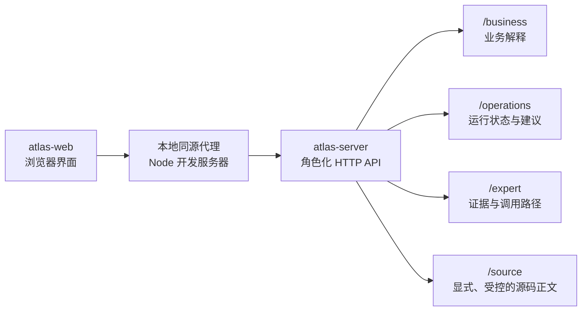

# atlas-web：角色化 Explorer

## 结论

`ui-layer/atlas-web` 是 Atlas 的独立浏览器界面。它不属于 Maven 发布物，不扫描项目源码，也不读取 Workspace、source JAR、数据库或 Axon。它只请求服务端已经解释好的业务、运维和专家 JSON，再把这些内容组织成易读的页面。



这样，业务人员不需要打开开发者工具或源码，运维人员不会把“未采集”读成成功，专家也只在需要时、且服务端明确允许时，才查看 `src.jar` 中的正文。

## 页面如何对应三种角色

| 页面 | 使用的读取模型 | 页面优先回答的问题 | 不显示的内容 |
| --- | --- | --- | --- |
| 业务地图 | `/business` | 规则是什么？事件发生后谁处理、哪里可见？Saga 在等待什么？接口做什么？ | Java 全限定名、调用栈、事件存储实现细节 |
| 运行态 | `/operations` | 哪个 Projection / Process Manager 成功、失败、积压或重试？受影响的目标和处理建议是什么？ | 原始 payload、异常正文、堆栈、未白名单属性 |
| 专家模式 | `/expert`、`/assets/{id}` | 哪条静态关系证明了结论？接口调用如何展开？源码在哪里？ | Workspace 绝对路径、任意本机文件 |

专家模式的“查看受控源码”是用户动作触发的第二次查询；它不是默认加载内容。若服务没有 `--enable-expert-source`，界面会直接展示服务端的 `EXPERT_SOURCE_DISABLED` 说明。

## 本地启动

先在一个终端启动 Atlas 服务。`workspace/local/atlas-workspace.yaml` 是私有文件，不应提交：

```powershell
& 'C:\Program Files\Java\jdk-22\bin\java.exe' -jar `
  .\ui-layer\atlas-server-bootstrap\target\explicit-architecture-atlas-server-bootstrap-0.1.0-SNAPSHOT-runner.jar `
  --workspace .\workspace\local\atlas-workspace.yaml `
  --port 8080
```

再在另一个终端启动 Web：

```powershell
Set-Location .\ui-layer\atlas-web
npm run dev
```

开发服务器默认只监听 `127.0.0.1:4173`，并把 `/api/*` 和 `/health` 同源转发到 `http://127.0.0.1:8080`。因此浏览器不需要保存凭据或处理 CORS。打开页面后输入 Package ID，例如 `package:etc:current`。

若 Atlas 服务不在默认地址，可在启动 Web 前设置：

```powershell
$env:ATLAS_API_BASE = 'http://127.0.0.1:8090'
$env:ATLAS_WEB_PORT = '4173'
npm run dev
```

界面会把最后一次使用的 API 地址和 Package ID 保存在浏览器本地存储，便于重新打开；它不会保存 Workspace、source JAR 路径、令牌、源码或运行 payload。

## 本地 API 的跨域边界

Atlas server 默认只监听回环地址。它只会向 `http(s)://localhost:*`、`http(s)://127.0.0.1:*` 或 `http(s)://[::1]:*` 返回 CORS 许可，绝不会使用 `Access-Control-Allow-Origin: *`。这使独立 Web 可以直接连接本机 runner，同时避免任意远程网页读取本机 Atlas。

CORS 不是鉴权；目前真正的边界仍然是回环监听，以及专家源码必须显式使用 `--enable-expert-source`。若将来要对内网或公网发布，应在身份认证、授权、审计和可信反向代理之后部署，而不是放宽当前 runner 的监听或 CORS 规则。

## 验证

界面没有前端依赖；只需 Node.js 20 或更高版本：

```powershell
Set-Location .\ui-layer\atlas-web
npm run check
```

该检查验证浏览器模块和本地代理的语法。服务端 HTTP 路由、Package 读取和真实 socket 已由 Maven 测试覆盖：

```powershell
& 'C:\Program Files\JetBrains\IntelliJ IDEA Community Edition 2023.3.2\plugins\maven\lib\maven3\bin\mvn.cmd' test
```

## 渲染边界

- Web 只渲染 `/business`、`/operations`、`/expert` 和专家资产详情；不读取原始 `AtlasPackage` JSON。
- 业务页面不能从专家调用链反推或编造业务流程。
- 运行态的 `NOT_CAPTURED`、`UNKNOWN`、`FAILED`、`LAGGING`、`RETRYING` 必须使用不同的文字和视觉状态，不能统一显示为正常。
- 从 Package 返回的所有文本都按不可信文本处理并进行 HTML 转义；源码正文只放在 `<pre><code>` 中。
- UI 可被静态托管，但生产环境应为 `/api` 配置可信同源反向代理；不要让浏览器直接访问包含私有 Workspace 的文件系统。
