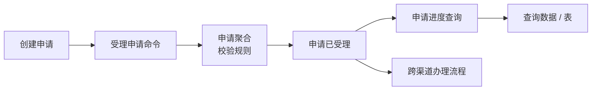

# Atlas 解决什么问题

## 一句话理解

业务系统通常只告诉你“可以提交什么”和“当前结果是什么”；决定结果的知识却分散在领域代码、事件、投影、运维记录和少数人的经验中。Atlas 将这些已经有证据的知识整理为一张可阅读、可追溯的业务地图。

它首先回答的不是“这个类调用了哪个方法”，而是：

- 这条业务规则是什么，为什么必须遵守？
- 业务操作完成后，发生了什么事实？
- 这个事实会由谁处理，最终哪些查询数据应该可见？
- 一项跨业务自动流程正在等待什么，何时重试或人工介入？
- 页面未更新时，是静态设计没有这条关系、运行态未采集，还是处理真的失败？

## 一条规则怎样从代码变成可读知识

以“客户编号”一类稳定业务身份为例。代码可能包含正则、构造工厂、`requireTrue` 和异常；这些是实现证据，但业务人员不应先面对它们。

Atlas 的业务页面首先会表达：

```text
规则：客户编号必须符合其客户类别。

个人客户使用 20 位数字编号并以 1 结尾；单位客户使用 18 位数字编号并以 2 结尾。
该编号用于客户建档、历史导入、事件重放和跨业务关联；不能用手机号、证件号或其他账户号替代。
```

开发者在专家模式中才可展开看到正则表达式、实际校验方法、源码位置和测试证据。两种描述指向同一个资产，并不互相矛盾。

## Atlas 不是“猜图”工具

Atlas 的可信度来自明确边界：

| 信息 | 可以来自哪里 | Atlas 不会做什么 |
| --- | --- | --- |
| 技术事实 | Java、POM、Spring、Axon、JPA 等源码和配置 | 不启动业务系统、不反射加载项目、不为无法解析的调用补边 |
| 业务意图 | `@Atlas…` 注解和版本化 Intent Manifest | 不用注解覆盖相反的源码事实 |
| 运行态 | 私有、脱敏的 Axon 离线观测 | 不连接生产 Event Store、不保存 payload 或异常栈 |
| 人工说明 | 受控内容包、业务和运维文档 | 不把文档计划伪装成“已运行” |

因此，Atlas 能够说“已证明”“已声明”“本次观察到”或“无法判断”，而不是把所有内容染成同一种绿色状态。

## 一张图，三种解释

同一份 Package 中可能有这样一条链路：



| 读者 | 优先看到的解释 |
| --- | --- |
| 业务人员 | “提交申请后会受理、更新进度，并开始渠道办理。” |
| 运维人员 | “进度投影最近一次失败/积压/重试了吗？影响了哪些查询目标？应该先做什么？” |
| 专家 | Endpoint、命令派发、事件生产/消费、投影写入、调用边和源码证据。 |

角色化并不是隐藏事实，而是防止读者先被不需要的技术细节淹没。页面切换不会重新扫描或推断源码；它只是读取同一个 Package 的不同视图。

## Atlas 的边界

Atlas **会做**：解释、关联、展示、诊断和追溯。它 **不会做**：

- 代替交易、审批、录入或真正的业务系统页面；
- 修改业务数据、重放命令或替代 EventOps；
- 从看起来相似的代码中“推测”领域模型；
- 把 Workspace 路径、凭据、未脱敏 payload 或 source JAR 路径交给浏览器；
- 要求业务人员学习 Explicit Architecture 的实现细节。

下一步请阅读[从零到第一次查看](02-从零到第一次查看.md)，把这张地图实际生成并打开。
