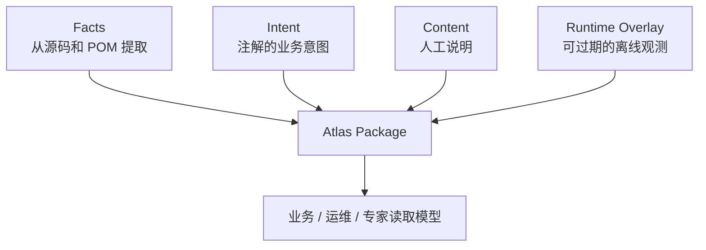

# 理解 Atlas Package

## Package 是什么

Atlas Package 是 Atlas 的稳定交换边界。它把不同来源的信息编排在同一个版本化 JSON 中，但**不把它们混成同一种真相**。浏览器默认只读角色化 HTTP 视图；Package 原始 JSON 是审计、离线保存和专家工具的输入，不是前端自行推理的数据库。



## 六个关键组成

| 组成 | 回答什么 | 典型来源 | 不能被误读成 |
| --- | --- | --- | --- |
| `manifest` | 这是哪份快照、哪个版本、哪些能力覆盖了？ | 生成命令和分析器 | 当前生产运行状态 |
| `designAtlas` | 哪些概念、事件、投影、流程、接口及关系可解释？ | Facts + Intent + Content 的归一结果 | 所有源码的完整镜像 |
| `facts` | 从技术材料中确认了什么？ | Java、POM、Spring、Axon、JPA | 人工业务承诺 |
| `intents` | 架构师或领域开发者明确声明了什么？ | 编译期 Intent Manifest | 已在生产运行的事实 |
| `content` | 业务和运维如何补充可读说明？ | 受控内容包 | 源码证据的替代品 |
| `runtimeOverlay` | 本次受控采集看到了什么处理状态？ | 脱敏 Axon 离线导出 | 永久静态设计 |

`runtimeOverlay` 是可选且会过期的。执行新的 `extract` 时不要把旧运行态当作源码事实；执行 `observe` 时也不会改写静态 Facts 和 Design Atlas。

## Evidence：为什么 Atlas 敢这样说

任何关键节点或关系都应有 Evidence。Evidence 说明结论来自源码、注解、文档还是运行态，并且包含受控定位符，例如：

- `project://`：项目源码中的位置；
- `maven://`：POM/Reactor 声明；
- `generated://`：编译期 Intent Manifest；
- `runtime://axon/...`：离线观测批次；
- `archive://`：经授权的源码归档定位。

这些 URI 是证据锚点，不是本机绝对路径。它们让专家可以受控地回到来源，也避免 Package、Web 或日志泄露 `C:\...`、私有仓库地址或 source JAR 路径。

## Coverage 和诊断比“空列表”更重要

Atlas 对每个分析器报告覆盖状态。阅读结果时请采用下列规则：

| 你看到的情况 | 正确解释 |
| --- | --- |
| `COMPLETE` | 在该分析器定义的范围内，提取已完成；仍不等价于生产运行成功。 |
| `PARTIAL` | 有些输入或关系不能确定；结合诊断阅读，不补猜测边。 |
| `NOT_ENABLED` | 本次没有启用该能力；不能据此说系统没有对应关系。 |
| `NOT_IMPLEMENTED` | 模块/契约可能预留了能力，但当前未实现提取。 |
| 关系列表为空 | 先看 coverage 和 diagnostics；只有覆盖充分时才可能说明未发现该关系。 |

例如，一个投影没有表名，可能是代码未显式写 `@Table`，也可能 JPA 分析器未启用。Atlas 不会按照命名策略臆测物理表名。

## Package 身份与历史

`packageId` 不是文件名，也不是 Maven 坐标。它是调用 API、关联历史快照和展示页面的稳定文本，例如：

```text
package:etc:2026-08-04
```

`projectId` 标识被分析的项目，`sourceRevision` 标识源码版本，`generatedAt` 表示静态 Package 的生成时间，`runtimeCapturedAt` 则只属于运行态采集时间。比较两个 Package 时，先比较这些身份和 coverage，再比较节点/关系数量；不能只看“图变大了还是变小了”。

## 当前哪些事实可以提取

当前静态链路已支持：Java 类型/字段/方法、`Pattern.compile` 与常见 guard、Maven Reactor/直接依赖、Spring 路由与 Command 派发、Axon 命令/事件/Saga、JPA 实体/显式表列/投影写入。运行态链路支持脱敏 Axon 观测确定性关联到 Projection 或 Process Manager。

完整输入范围和限制见[数据包、Workspace 与隐私边界](../architecture/03-数据包、Workspace与隐私边界.md)。读完本页后，继续看[按角色阅读 Atlas](04-按角色阅读Atlas.md)，把 Package 内容转成实际问题的答案。
