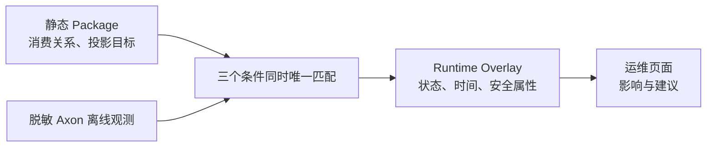

# 运行态与运维处置

## 静态设计与运行状态是两件事

静态 Package 可以证明“设计上 `事件 → 投影 → 数据目标` 存在”；Runtime Overlay 只能说明“在某次受控采集中，这个投影或 Process Manager 的处理状态是什么”。二者需要关联，但绝不能互相替代。



## 导入前的安全检查

运行态输入必须位于 `workspace/local/` 或等价的受控目录。它应是离线导出，而不是让 Atlas 直接取得 Event Store、Saga Store、数据库或监控平台凭据。

Workspace 需要显式启用：

```yaml
runtime:
  enabled: true
  observationFiles:
    - "runtime/axon-observations.json"
```

导出 JSON 中允许保留的常用字段包括事件类型、处理器类型、观测时间、`SUCCEEDED`/`FAILED`/`LAGGING`/`RETRYING` 状态、延迟、重试次数、错误分类、处理组和消息身份。payload、账号、证件、异常消息和堆栈会在进入 Atlas 前丢弃。

## 为什么要求“确定性关联”

一条运行态记录只有同时满足下面三点才会归属某个资产：

1. `eventType` 唯一对应静态 `DomainEvent`；
2. `handlerType` 唯一对应静态 Projection 或 Process Manager；
3. 静态图存在该事件到该处理器的 `CONSUMES` 关系。

任何一步不唯一或不存在，Atlas 只产生诊断。例如 `RUNTIME_EVENT_NOT_IN_STATIC_ATLAS` 表示导出事件与静态 Package 对不上；它不是 Atlas 可以通过相似类名“猜出来”的情况。

## 操作流程

```powershell
java -jar infra-driving/atlas-cli/target/explicit-architecture-atlas-cli-0.0.1.jar observe `
  --workspace workspace/local/atlas-workspace.yaml `
  --package-id package:my-project:2026-08-04
```

`observe` 会读回已有 Package，替换其中可过期的 `runtimeOverlay`，保留静态 `designAtlas`、Facts 和 Intent，并打印状态计数、需要关注的资产和无法关联的诊断。刷新 Web 后才会看到新结论。

## 处置优先级

| 现象 | 先做什么 | 再做什么 |
| --- | --- | --- |
| `NOT_CAPTURED` | 确认采集开关和导出范围 | 重新导出；不要宣布系统正常 |
| `UNKNOWN` | 确认该处理器被采集且静态 Package 版本正确 | 检查事件/处理器身份和消费边 |
| `FAILED` | 查看安全错误分类与重试次数 | 沿静态投影目标确认可能受影响的查询 |
| `LAGGING` | 查看积压、处理组和吞吐 | 观察数据最终可见时间，必要时扩容/限流 |
| `RETRYING` | 观察是否持续恢复 | 超阈值后按既有故障流程人工介入 |
| `SUCCEEDED` 但业务不可见 | 核对查询过滤、权限、读模型目标 | 不要立刻把问题归因于事件未消费 |

完整 JSON Schema、诊断代码和状态语义见[运行态投影健康度与运维处置](../operations/01-运行态投影健康度.md)。
