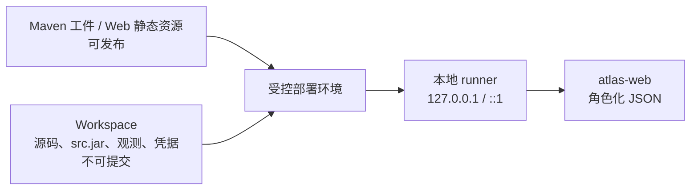

# 安全部署与发布

## 先记住三条边界

1. **Maven 工件可复用，真实业务输入不可复用。** 通用模型、分析器、CLI 和 server 可以发布；项目路径、业务内容、观测、凭据和归档必须留在私有环境。
2. **浏览器只拿角色化 JSON。** 它不读取 Workspace、不上传本机路径、不持有 Event Store 或数据库凭据。
3. **V1 runner 只监听回环地址。** 它没有身份认证，不能直接暴露到办公网或公网。



## Workspace 的正确位置

仓库只能提交 `workspace/atlas-workspace.example.yaml`。实际配置放在 Git 忽略的：

```text
workspace/local/
├─ atlas-workspace.yaml
├─ packages/
├─ source-cache/
├─ content/
└─ runtime/
```

不要提交或写入 Package：绝对路径、私有 Maven 地址、token、数据库/Event Store/Saga Store 连接、未脱敏 payload、异常正文、真实业务手册、人员责任信息和 source JAR 路径。

## Web、CORS 与源码查看

`atlas-web` 的本地开发服务器默认监听 `127.0.0.1:4173`，并代理到 runner 的 `127.0.0.1:8080`。runner 只允许以下浏览器 Origin 的 CORS：

- `http(s)://localhost:*`；
- `http(s)://127.0.0.1:*`；
- `http(s)://[::1]:*`。

它不会使用 `Access-Control-Allow-Origin: *`。CORS 不是鉴权，但这样可以防止任意远程网页读取本机 Atlas 服务。

专家源码端点默认关闭。只有显式加入 `--enable-expert-source`、Workspace 声明 `sources.sourceArchives`、资产属于当前 Package 且映射唯一时，服务端才从允许的 source JAR 中读取对应条目。它不接受浏览器传来的文件路径。

## 需要远程访问怎么办

不要把当前 runner 的监听地址或 CORS 白名单扩大到公网。正确方式是：

1. 将 runner 放在可信反向代理之后；
2. 由网关提供身份认证、角色授权、审计、TLS 与速率限制；
3. 明确区分业务、运维和专家权限，专家源码权限应最小化；
4. 为 `/api` 配置同源反向代理，再部署 Web 静态资源；
5. 保持 Workspace 和 source Archive 只对服务进程可读。

这属于未来部署能力的扩展，不能误认为当前无认证本地 runner 已经具备企业级远程访问控制。

## Maven 发布边界

发布由受保护 CI 完成。CI 才能持有 `settings.xml`、签名密钥和发布仓库凭据；本机和 POM 不应硬编码它们。发布前至少执行 Maven 完整测试、Web 语法检查和结构校验，并在干净消费者工程中验证 BOM 与传递依赖。

哪些模块可发布、哪些目录永远不发布，见[工程结构与 Maven 发布](../architecture/01-工程结构与Maven发布.md)；完整发布清单见[本地开发、构建与发布](../contributors/01-本地开发、构建与发布.md)。
