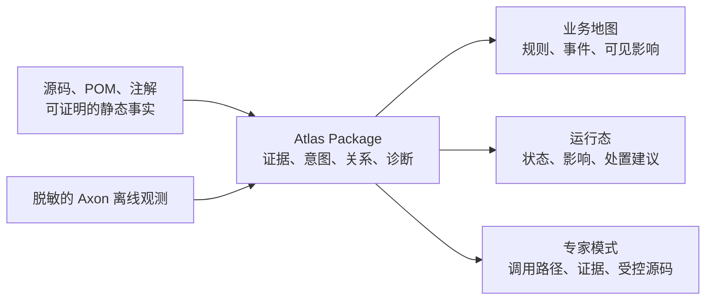

# Explicit Architecture Atlas 中文 Wiki

> **这套 Wiki 面向 Atlas 的使用者，而不是只面向源码贡献者。**
>
> 如果你想知道“这项业务为什么不能办理”“某个事件之后哪些数据会更新”“现在卡在哪个处理环节”，请从这里开始；不需要先学习 Java、DDD、CQRS、Axon 或数据库。

Atlas 会把严格 Explicit Architecture 项目中的可证明事实编译为一份版本化的 **Atlas Package**，再以业务、运维和专家三种方式解释它。它不是另一个交易系统、监控系统或自动画图工具；它不修改业务数据，也不依赖 AI 猜测业务含义。



## 先选你的阅读路径

| 你是谁 | 先读 | 然后读 | 你会得到什么 |
| --- | --- | --- | --- |
| 业务/产品/客服人员 | [Atlas 解决什么问题](01-Atlas解决什么问题.md) | [按角色阅读 Atlas](04-按角色阅读Atlas.md) | 不看源码也能理解规则、事件和业务数据何时可见 |
| 运维/平台工程师 | [从零到第一次查看](02-从零到第一次查看.md) | [运行态与运维处置](05-运行态与运维处置.md) | 正确解读失败、积压、重试和“未采集到” |
| 开发者/架构师 | [理解 Atlas Package](03-理解AtlasPackage.md) | [让系统更可解释](06-让系统更可解释.md) | 了解证据、注解、调用路径与源码查看边界 |
| 部署/发布维护者 | [从零到第一次查看](02-从零到第一次查看.md) | [安全部署与发布](07-安全部署与发布.md) | 保护 Workspace、源码归档和运行态导出 |
| Atlas 贡献者 | [扩展 Atlas](08-扩展Atlas.md) | [本地开发、构建与发布](../contributors/01-本地开发、构建与发布.md) | 在不破坏 Maven 与数据包边界的前提下扩展能力 |

## Wiki 目录

1. [Atlas 解决什么问题](01-Atlas解决什么问题.md)：产品定位、能力边界，以及一条业务事实如何被解释。
2. [从零到第一次查看](02-从零到第一次查看.md)：准备私有 Workspace、生成 Package、启动服务和 Web。
3. [理解 Atlas Package](03-理解AtlasPackage.md)：Facts、Intent、Content、Runtime Overlay、Evidence、Coverage 与诊断。
4. [按角色阅读 Atlas](04-按角色阅读Atlas.md)：业务、运维、专家页面分别怎样读，不能怎样读。
5. [运行态与运维处置](05-运行态与运维处置.md)：脱敏 Axon 观测的导入、确定性关联和状态含义。
6. [让系统更可解释](06-让系统更可解释.md)：何时写注解、如何写出业务语言、如何处理证据冲突。
7. [安全部署与发布](07-安全部署与发布.md)：Workspace、src.jar、CORS、回环监听和 Maven 发布边界。
8. [扩展 Atlas](08-扩展Atlas.md)：添加分析器、演进 Schema、测试和发布新能力。
9. [常见问题](09-常见问题.md)：第一次使用时最常见的误解、错误和排查入口。

## 五分钟预览

在仓库根目录先完成构建，再使用私有 Workspace 生成一份 Package：

```powershell
mvn -B verify

java -jar infra-driving/atlas-cli/target/explicit-architecture-atlas-cli-0.1.0-SNAPSHOT-all.jar extract `
  --workspace workspace/local/atlas-workspace.yaml `
  --package-id package:my-project:2026-08-04 `
  --source-revision working-tree
```

之后启动本地查询服务和 Web：

```powershell
java -jar ui-layer/atlas-server-bootstrap/target/explicit-architecture-atlas-server-bootstrap-0.1.0-SNAPSHOT-runner.jar `
  --workspace workspace/local/atlas-workspace.yaml --port 8080

npm --prefix ui-layer/atlas-web run dev
```

打开 `http://127.0.0.1:4173`，输入 `package:my-project:2026-08-04`。详细、可复制的操作和前置条件见[从零到第一次查看](02-从零到第一次查看.md)。

## 当前版本能做什么，不能做什么

当前可执行链路已经能够提取 Maven/Java/Spring/Axon/JPA 的静态事实，读取编译期 Intent Manifest，导入受控的 Axon 离线观测，并提供角色化 HTTP API 与独立 Web。`manifest.coverage` 会说明每项分析器是 `COMPLETE`、`PARTIAL`、`NOT_ENABLED` 还是 `NOT_IMPLEMENTED`；没有关系绝不等于“系统中一定没有这项业务能力”。

当前 CLI 的 `extract` 会将内容包作为空 Bundle 写入，私有内容包的读取器尚未接入这条 CLI 命令。因此，不应把 `content.root` 配置为“已经会自动导入业务手册”；它目前是受控边界和后续扩展点。与事实不一致的说明也不能取代源码或运行态证据。

需要查阅模块、Maven 工件和参考契约时，请回到[工程文档导航](../README.md)。这套 Wiki 的职责是帮助人先建立正确心智模型，再进入相应的专题说明。
