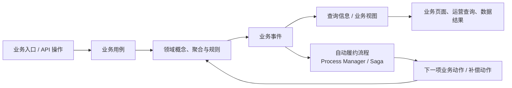
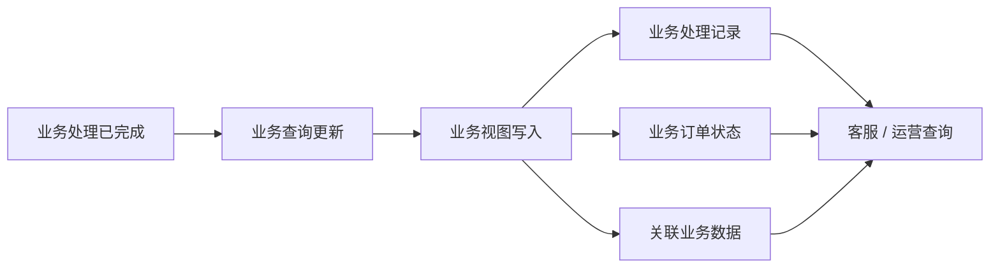
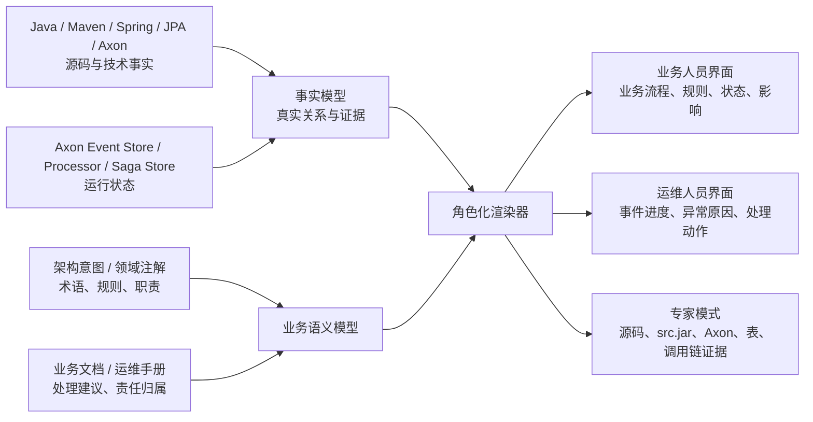

# Explicit Architecture Atlas

> **让业务规则、事件、投影、自动流程和接口处理过程成为人人可读的系统知识。**

Explicit Architecture Atlas（以下简称 **Atlas**）是一个将 Explicit Architecture、DDD、事件驱动设计、CQRS 与 Axon 实现事实转换为可交互知识界面的工具。

它不是普通业务系统，也不是只给开发者看的代码关系图。Atlas 的目标是让业务人员、运维人员和开发者围绕同一套真实信息协作：业务人员不需要阅读代码或系统性学习架构，也能理解一项业务如何推进、为什么被拦截、数据何时可见；运维人员可以定位事件、投影和自动流程的运行状态；开发者则可以进一步回到源码、`src.jar`、Axon 和持久化证据。

Atlas 不绑定任何特定业务仓库、行业或实现项目。它面向所有严格遵循 Explicit Architecture 的系统：只要系统能够清晰地区分领域核心、应用用例、主动适配器、被动适配器、事件、投影与流程协调，Atlas 就能够将其架构资产转换为面向不同角色的可读知识界面。

## 工程实施与文档

当前仓库已经落下可执行的 Maven Reactor 工程：领域模型、应用 API/Core、分析 SPI、JVM/Maven/Spring/Axon/JPA 适配器、Axon 运行态入口、源码归档读取器、注解 API、编译处理器、Maven Plugin、CLI、HTTP 边界与服务组合根均有独立模块。JPA 适配器已经能把实体、显式表/列、Spring Data Repository 与投影的写入调用归一为可追溯的 `Projection → Entity → Table` 关系；通用 fixture 会在编译期生成 `atlas-intent.json`，CI 同时校验 Maven、独立 Web 与目录边界。

其中可复用的非渲染能力以 Maven 工件发布；`atlas-web` 保持独立 Node/Web 工程；真实项目路径、源码归档、运行态观测、凭据和业务内容只能放在 Git 忽略的 `workspace/local/` 或外部安全系统。完整目录、发布、依赖、数据包、注解和开发说明见 [工程文档](docs/README.md)。

## 要解决的问题

传统业务系统通常只呈现“可以做什么”和“当前结果是什么”。大量决定业务为何这样执行的知识，分散在源码、事件表、架构文档、运维手册和开发人员经验中：

- 一个客户编号为什么不合法？
- 一项业务申请目前走到了哪一步，接下来由谁处理？
- 一次业务操作完成后，系统会产生哪些业务事实？
- 某项业务事实发生后，哪些查询信息应当更新；未更新时问题卡在哪里？
- 某个事件由谁产生、由谁消费、最终影响哪些业务数据？
- 一个跨上下文长流程在等待什么、何时重试、失败时怎样补偿？
- 某个 HTTP 接口进入系统后，经过哪些业务步骤并触发哪些异步后续动作？

Atlas 将这些问题转化为可浏览、可搜索、可追溯且按用户角色渲染的知识。

## 产品定位

Atlas 的核心不是画一张静态架构图，而是构建一张由真实证据支撑的**业务因果图谱**：



同一张图谱向不同人呈现不同的信息密度：

| 用户 | 默认看到什么 | 不需要学习什么 |
| --- | --- | --- |
| 业务人员 | 业务流程、业务规则、当前状态、责任方、下一步和常见问题 | Java、DDD、Axon、表结构、调用栈 |
| 运维人员 | 事件进度、处理器状态、投影可见性、失败原因、重试与处理动作 | 业务代码实现细节 |
| 开发者 / 架构师 | 调用链、源码、`src.jar`、事件字段、Axon 配置、DAO、表、约束执行点 | 无；可获得完整证据 |

业务界面与专家界面不是两套互相矛盾的数据，而是同一份 Atlas 模型的不同渲染方式。

## 核心能力

### 1. 领域概念与设计意图

Atlas 以业务概念而不是类名为主要入口，展示：

- 业务主体、聚合、实体、值对象和稳定业务身份；
- 每个概念承担的业务职责；
- 概念之间的业务关系与归属；
- 状态、状态变化与可执行的领域规则；
- 每项规则的业务解释、执行时机、失败原因和处理建议。

例如，一个用于承载客户业务身份的 `CustomerId`，不会首先以 Java 类名或正则表达式呈现，而会展示为：

```text
客户编号

客户编号是客户业务身份，用于识别客户、关联业务记录和追踪客户办理过程。

规则
  - 客户编号不能为空。
  - 个人客户编号为 20 位数字，最后一位为 1。
  - 单位客户编号为 18 位数字，最后一位为 2。
  - 客户编号表达的类别必须与个人 / 单位客户类别一致。

适用场景
  - 客户建档
  - 历史数据导入
  - 事件重放
  - 跨业务关联
```

专家模式下，用户可以展开查看对应的 `Pattern`、`requireTrue`、Factory、调用点、Javadoc 和测试证据。

### 2. 领域约束（Domain Constraints）

领域约束是 Atlas 的一等模型对象。它不只解释字段校验，还解释业务状态为什么合法、何时可以变化以及系统如何持续维护这些条件。

Atlas 至少支持下列约束类型：

| 约束类型 | 业务示例 |
| --- | --- |
| 必填约束 | 客户编号不能为空 |
| 身份格式约束 | 个人客户编号与单位客户编号具有不同的长度和尾位 |
| 数值范围约束 | 变更金额必须大于零且不能超过允许范围 |
| 跨概念一致性 | 业务身份中的类别标识必须与主体类别一致 |
| 唯一性约束 | 同一业务对象不能建立重复的有效关系 |
| 状态迁移约束 | 业务单据只能按允许的状态路径变化 |
| 事件前置条件 | 事件必须能关联到正确的业务身份，重复或乱序事件必须被识别 |
| 时序约束 | 预占、确认、超时、重试和失效必须遵守时间规则 |
| 所有权约束 | 只有数据所属的业务上下文可以修改业务事实 |
| 补偿约束 | 跨上下文流程失败后必须释放或撤销先前预占的资源 |

每个约束都应能够回答：

1. 规则是什么？
2. 它影响哪个业务概念或业务流程？
3. 哪些操作会触发校验？
4. 是硬性强制规则，还是辅助判断规则？
5. 校验失败后，用户应如何处理？
6. 规则在源码、测试和文档中的证据是什么？

### 3. 事件生产者、消费者与事件契约

事件是 Atlas 的中心连接点。每一个事件都应以“业务事实”呈现，而不是只显示 Java 类名。

例如，`BusinessOrderCreatedEvent` 可以默认呈现为“业务订单已创建”，并展示：

- 在什么业务动作完成后发生；
- 由哪个聚合或用例产生；
- 事件携带的关键业务信息；
- 哪些消费者会处理它；
- 每个消费者的业务目的；
- 是否已经被 Axon Event Store 记录；
- 是否存在积压、失败、重试、死信或延迟。

事件字段需要按业务意义分类，而不是只列 Java 属性：

| 字段类别 | 例子 |
| --- | --- |
| 业务身份 | 客户编号、业务订单号、申请单号、资源编号 |
| 业务事实 | 金额、渠道、状态、客户类别、产品选择 |
| 关联信息 | 订单号、申请号、关联聚合 ID |
| 追踪信息 | 事件 ID、发生时间、关联编号、因果编号、版本号 |
| 敏感信息 | 仅限授权人员按脱敏规则查看 |

### 4. 投影与业务数据可见性

Atlas 不会只展示“某个 Handler 消费了事件”，还会追踪事件处理后的业务结果。



业务与运维视图优先回答：

- 这个事件处理完成后，哪些业务查询会更新？
- 数据什么时候可见，是否存在异步延迟？
- 如果页面或查询未更新，应检查哪个事件处理环节？
- 当前处理器是否正常、是否积压、失败后是否正在重试？

开发者可进一步展开到 `@EventHandler`、`@ProcessingGroup`、Writer、DAO、JPA `@Table`、SQL/Mapper、缓存、外部系统或具体数据库表。

### 5. Process Manager / Saga

对业务人员，Saga 默认呈现为“自动履约流程”或“跨业务协同流程”，而不是技术术语。

它回答：

- 一项申请受理后，系统会自动推进哪些步骤？
- 目前在等待客户、柜员、外部渠道还是系统自动处理？
- 何时超时、重试、人工介入或自动补偿？
- 失败时会撤销什么已完成动作？
- 谁对下一步负责？

专家模式下，Atlas 再展示 Axon Saga 的技术事实：

- `@Saga`、`@StartSaga`、`@SagaEventHandler` 与 `@EndSaga`；
- 事件关联键（association property）；
- Saga 发送的 Command、等待的事件、Deadline 和补偿命令；
- `saga_entry`、`association_value_entry`、实例状态和运行记录。

Atlas 必须区分以下三种状态，不能把设计意图伪装成已运行功能：

| 状态 | 说明 |
| --- | --- |
| 已实现 | 源码中存在真实 Process Manager / Saga，关系可追溯 |
| 基础设施可用 | Axon Saga Store、表和运行配置已具备，但尚未发现具体 Saga 实现 |
| 已声明 / 待落地 | 文档中已定义该流程职责，源码尚未实现 |

### 6. 接口与业务处理路径

Atlas 可以从 Spring Endpoint 自动提取 HTTP 方法、路由、入参、返回类型以及后续调用关系；但业务人员看到的首先是“业务操作”。

例如，一个用于创建业务订单的 HTTP 接口，默认呈现为：

```text
业务操作：创建业务订单

提交后系统会做什么？
  1. 校验业务信息。
  2. 创建业务订单。
  3. 记录业务事实。
  4. 返回受理结果或后续办理凭证。
  5. 等待下游渠道或自动流程处理结果。
  6. 更新相关业务查询信息。

可能的后续状态
  已创建、处理中、处理成功、处理失败、已取消、待补充资料、已完成。
```

专家模式或开发者模式中，可以展开完整调用链，并通过 `src.jar` 或项目源码查看链上实现：

```text
POST /api/business-orders
  → BusinessOrderController.create(...)
  → CommandGateway
  → BusinessOrderCommandHandler.handle(...)
  → BusinessOrderApplicationService.create(...)
  → BusinessOrder Factory / Aggregate
  → BusinessOrderCreatedEvent
  → Axon Event Store
  → BusinessOrderProjectionHandler
  → BusinessOrderProjectionWriter
  → 查询视图 / DAO / 表
```

## 信息来源与可信度

Atlas 不通过 AI 猜测架构或业务含义。每条展示的信息必须来自可识别来源，并带有来源和状态。



每个节点、关系和说明可以具有以下来源状态：

| 状态 | 来源 | 含义 |
| --- | --- | --- |
| `DECLARED` | Atlas 注解、`atlas-intent.yaml`、ADR | 明确声明的架构或业务意图 |
| `DERIVED` | Java、Maven、Spring、JPA、源码调用关系 | 可从代码确定提取的事实 |
| `AXON_CONFIGURED` | Event Store、Processor、Saga Store 配置 | 已具备的 Axon 基础设施能力 |
| `RUNTIME_OBSERVED` | Axon 事件、处理器、Saga 实例、监控数据 | 运行时观察到的事实 |
| `PLANNED` | 已批准的设计或领域文档 | 尚未落地、不得误认为已运行的能力 |

## Atlas 注解与内容治理

源码、Spring、Axon 和 JPA 已经表达的技术事实应由 Extractor 自动读取，Atlas 不要求重复注解。例如，`@EventHandler`、`@SagaEventHandler`、`@ProcessingGroup`、`@PostMapping`、`@Table` 都是技术事实来源。

Atlas 注解只补足代码无法可靠表达的设计语义，例如：

- 一个概念的稳定业务名称、别名、职责和所属上下文；
- 一个可执行约束的业务含义、严重程度和处理建议；
- 一个事件代表的业务事实、对业务的影响和用户可见结果；
- 一个投影服务哪些查询、面向哪些业务角色；
- 一个自动流程的目的、责任方、等待、超时和补偿语义；
- 一个 Endpoint 或 Command 对应的业务用例和业务旅程；
- 领域文档、ADR、运维手册与代码锚点的关联。

当前已提供的编译期注解包括：

```text
@AtlasContext
@AtlasAggregate
@AtlasConstraint
@AtlasEvent
@AtlasProjection
@AtlasProcessManager
@AtlasEndpoint
```

注解 API 的字段和使用边界见[注解、处理器与意图产物](docs/annotation-guide/01-注解、处理器与意图产物.md)。原则是不在注解中重复正则、SQL、路由或 Axon 关系等可从源码获取的信息；注解只保存稳定 ID、业务语义与文档锚点。

业务说明、常见问题、SLA、责任人和处理动作不应强制由业务人员修改 Java 文件。它们应通过独立内容包维护，例如：

```text
atlas-intent.yaml       # 架构师 / 核心开发者维护的稳定意图与映射
atlas-content.yaml      # 业务、产品、运维维护的可读说明与处理建议
scenarios/*.yaml        # 业务旅程、事件影响与异常处置场景
```

## 设计原则

1. **业务语言优先。** 默认界面不以 Java 类名、SQL、正则、表名或 Axon 术语为主。
2. **渐进式展开。** 用户先看“发生了什么、为什么、下一步怎么办”，再按权限查看技术细节。
3. **事实与意图分离。** 已运行、已实现、已声明和待落地必须明确区分。
4. **每条关键结论可追溯。** 开发者可从业务解释回到文档、源码、`src.jar`、Axon 或持久化证据。
5. **不依赖 AI 猜测。** 自动提取只产生可验证事实；无法确定的业务含义必须显示为待声明。
6. **不让业务用户学习架构。** Explicit Architecture 是 Atlas 的解释引擎，不是业务人员必须掌握的前置知识。
7. **敏感信息最小暴露。** 事件实际 payload、账号、证件、联系方式等按角色和脱敏规则处理。

## 产品级验收标准

Atlas 的首个可交付版本必须能为一个符合 Explicit Architecture 的业务领域提供完整纵向解释：

- 一个可读的业务概念、状态与关键约束视图；
- 一个业务操作从入口到领域事实，再到异步后续处理的路径；
- 一组事件的生产者、消费者、契约字段和业务影响；
- 至少一个投影从事件消费到业务可见数据的完整目的地；
- 一个可解释的自动流程、等待、重试、超时或补偿场景；
- 运行态与设计意图、已实现与待落地状态的明确区分；
- 开发者可以从每项关键结论回到源码、`src.jar`、Axon 或持久化证据。

验收标准不是“画出了架构图”，而是让未阅读源码的业务或运维人员能够独立回答：

- 一项业务操作提交后，系统会发生什么？
- 当前业务为什么尚未完成？
- 哪一项业务规则阻止了继续处理？
- 某项业务事实发生后，哪些查询结果应该更新？
- 查询未更新时，事件可能卡在什么位置？
- 当前该由客户、人工处理人员、外部渠道还是系统自动流程处理？

## 后续迭代

1. **Atlas Core Model**：定义领域概念、领域约束、事件、投影、流程、接口和证据的统一版本化模型。
2. **Java / Axon Extractor**：提取 Maven 模块、Spring Endpoint、Command、Event、Projection、JPA 目的地、Saga 和调用关系。
3. **领域语义提取**：识别聚合身份、值对象、正则、`requireTrue`、状态 Guard、领域异常、Javadoc 和测试证据。
4. **最小注解框架**：只补充业务语义与文档锚点，不重复技术事实。
5. **业务/运维界面**：实现业务旅程、规则解释、事件影响、投影可见性和异常处理入口。
6. **专家模式**：支持源码、`src.jar`、调用链、Axon、DAO、表、配置和原始证据查看。
7. **Process Manager / Saga**：展示跨上下文履约、等待、重试、超时与补偿流程，并在真实 Saga 落地后接入运行态。
8. **CI 与质量校验**：校验意图引用、源码锚点、事件字段分类、投影目的地、Saga 状态与文档覆盖。

## 非目标

Atlas 在第一阶段不承担以下职责：

- 不替代业务系统的交易、审批或数据录入界面；
- 不修改业务数据、不发起业务命令、不替代 EventOps；
- 不通过 AI 自行判断某段代码“可能属于什么领域”；
- 不把所有代码、类、方法、表完整铺满主界面；
- 不要求业务人员理解 Java、DDD、CQRS、Axon 或数据库；
- 不因为引入 Atlas 而把现有业务系统改造成重型平台。

## 项目状态

当前项目已完成两条可执行的最终形态链路，而不是一次性原型：可发布 Maven 工件的边界、独立 Web 边界、私有 Workspace 边界、版本化 Schema、类型化 Atlas Package、事实/意图/内容/运行态的独立模型、能力覆盖与诊断、编译期意图索引、Maven/JVM/Spring/Axon 事实提取、文件型 Package 仓库、可执行 CLI 和端到端 fixture 测试均已建立。

当前 `atlas extract` 已经能够从严格显式架构样例中生成领域约束的业务说明、正则和源码证据，并恢复入口到领域方法的可确认调用边；还会提取 Spring MVC 的 HTTP 方法与路由、Command Gateway/Bus 派发、Axon 命令处理、`AggregateLifecycle.apply` 事件生产、事件消费者、事件 payload 字段，以及 Saga 的开始、等待、结束和后续命令。每条关系均保留源码证据。尚未实现的 JPA 投影目的地与运行态能力不会被渲染成“不存在”，而会由 Package 的 `coverage` 明确表达为未启用或未实现。

后续会以同一个 Package、同一个 Fact → Intent → Design Atlas 流水线继续接入 JPA 投影目的地、运行态 Overlay 和业务/运维/专家角色化 Explorer；源码专家模式可通过 Workspace 私有 `sourceArchives` 将 Package 的 `project://` 证据定位回 `src.jar` 条目。不会推倒已存在的数据包、Workspace 或 CLI 边界。具体工作继续遵守 [工程结构与 Maven 发布](docs/architecture/01-工程结构与Maven发布.md) 和 [依赖规则与装配](docs/architecture/02-依赖规则与装配.md) 的边界。
